# PROJETO DE SOFTWARE
ola teste talita
## *Stakeholders*
|NOME|CARGO|E-MAIL|
|:---|:---|:---|
|Gilberto Silva|Professor|gilberto.silva@ifro.edu.br|
|Taline França|Cliente|[E-MAIL]|


# Sumário

* [RESUMO DO PROJETO](#resumo-do-projeto)
* [INTRODUÇÃO](#introdução)
  * [PROPÓSITO DESTE DOCUMENTO](#propósito-deste-documento)
  * [CONCEPÇÃO DO SISTEMA](#concepção-do-sistema)
* [DESCRIÇÃO GERAL](#descrição-geral)
  * [USUÁRIOS DO SISTEMA](#usuários-do-sistema)
  * [ABRANGÊNCIA E SISTEMAS SIMILARES](#abrangência-e-sistemas-similares)
  * [SUPOSIÇÕES E DEPENDÊNCIAS](#suposições-e-dependências)
* [ESTUDO DE VIABILIDADE](#estudo-de-viabilidade)
* [PM CANVAS](#pm-canvas)
* [METODOLOGIA ADOTADA NO DESENVOLVIMENTO](#metodologia-adotada-no-desenvolvimento)
  * [MÉTRICAS](#métricas)
  * [DIFICULDADES E APRENDIZADOS](#dificuldades-e-aprendizados)
* [REQUISITOS DO SOFTWARE](#requisitos-do-software)
  * [MINIMUNDO](#minimundo)
  * [REQUISITOS FUNCIONAIS](#requisitos-funcionais)
  * [REQUISITOS NÃO FUNCIONAIS](#requisitos-não-funcionais)
  * [RASTREABILIDADE COM AS VERSÕES ANTERIORES](#rastreabilidade-com-as-versões-anteriores)
  * [REGRAS DE NEGÓCIO](#regras-de-negócio)
  * [USER STORIES](#user-stories)
  * [PENDÊNCIAS DE CONSISTÊNCIA COM O BANCO DE DADOS](#pendências-de-consistência-com-o-banco-de-dados)
* [PROTOTIPAGEM](#prototipagem)
* [MODELO LÓGICO DO BANCO DE DADOS](#modelo-lógico-do-banco-de-dados)
  * [DICIONÁRIO DE DADOS](#dicionário-de-dados)
* [DIAGRAMA DE ATIVIDADES](#diagrama-de-atividades)
* [DIAGRAMA DE SEQUÊNCIA](#diagrama-de-sequência)
* [DIAGRAMA DE CLASSES](#diagrama-de-classes)
* [DIAGRAMA DE CASOS DE USO](#diagrama-de-casos-de-uso)
  * [ESPECIFICAÇÃO DOS CASOS DE USO](#especificação-dos-casos-de-uso)
* [REFERÊNCIAS](#referências)


# RESUMO DO PROJETO

|ITEM|DETALHES|
|:---|:---|
|NOME| HERA — Hospedagem, Estadias, Reservas e Acomodações |
|MEMBROS DO PROJETO| Ana Clara Funari, Ana Claudia Santos Moura, Leticia Almeida e Thalita Cristina Chave Peronico |
|CLIENTE| Taline França |
|PRINCIPAL OBJETIVO| Desenvolver uma aplicação web que centralize a busca, o cadastro e o gerenciamento de acomodações e reservas de hospedagem, conectando clientes que procuram hospedagem a proprietários que oferecem acomodações. |
|BENEFÍCIOS ESPERADOS| Substituir o controle manual de acomodações e reservas por um sistema único, reduzindo erros (como reservas em períodos já ocupados), facilitando a organização do proprietário e tornando a busca e a reserva mais simples para o cliente. |
|INÍCIO E TÉRMINO PREVISTOS| 21/07/2026 - 08/12/2026 |
|ENTREGAS (MILESTONES)| Milestone 1: 15/09/2026 · Milestone 2: 20/10/2026 · Milestone 3 (Final): 08/12/2026 |


# INTRODUÇÃO

Hoje, as informações de hospedagem e reservas costumam ser gerenciadas de forma manual (anotações, planilhas, conversas em aplicativos de mensagem), o que dificulta a organização e aumenta a possibilidade de erros, como reservas sobrepostas ou dados desatualizados sobre preços e disponibilidade.

O HERA é uma aplicação web que centraliza esse processo. De um lado, o **cliente** pesquisa acomodações, consulta os detalhes e solicita reservas. Do outro, o **proprietário** cadastra e administra suas acomodações, informa a disponibilidade e acompanha as reservas recebidas.


## PROPÓSITO DESTE DOCUMENTO

Este documento descreve o projeto de software do HERA: o problema que ele resolve, para quem foi criado, os requisitos levantados, o protótipo, o modelo de dados e os diagramas UML que orientam o desenvolvimento.

## CONCEPÇÃO DO SISTEMA

Métodos utilizados para a obtenção dos requisitos do sistema:
  * Entrevista com a cliente (Taline França).
  * Análise de plataformas de hospedagem existentes.
  * Validação dos diagramas e do protótipo nas entregas de milestone.


# DESCRIÇÃO GERAL


## Usuários do sistema

| USUÁRIO | DESCRIÇÃO |
|:---|:---|
| **Cliente** | Pessoa que procura hospedagem. Pesquisa acomodações, consulta detalhes, solicita e cancela reservas, acompanha suas reservas e avalia a hospedagem após concluí-la. |
| **Proprietário** | Pessoa física ou jurídica que oferece acomodações. Cadastra e administra acomodações, informa a disponibilidade e os preços por período, acompanha as reservas recebidas e atualiza a situação delas. |
| **Administrador** | Responsável pela gestão da plataforma. Cadastra e gerencia cupons de desconto e consulta relatórios de reservas. |
| **Visitante** | Pessoa sem cadastro. Pode pesquisar e consultar hospedagens, mas precisa se cadastrar para reservar. |


## Abrangência e sistemas similares

O HERA abrange o ciclo da hospedagem: cadastro da acomodação, busca, reserva, acompanhamento e avaliação.

### Sistemas similares:
* Airbnb
* Booking.com


## Suposições e dependências

* Os usuários acessarão a plataforma por qualquer dispositivo com navegador e acesso à internet.
* O login com conta Google depende da disponibilidade do serviço de autenticação do Google.
* O envio do código de recuperação de senha depende de um serviço de e-mail.


# ESTUDO DE VIABILIDADE

O sistema é viável porque resolve um problema concreto da cliente (o controle manual de acomodações e reservas) com tecnologias web amplamente conhecidas pela equipe. O escopo foi dividido em três módulos — Gestão de Acomodações, Reserva de Hospedagem e Acompanhamento e Avaliação —, o que permite desenvolver e validar cada parte de forma incremental.


# PM CANVAS

O Project Model Canvas foi elaborado no Milestone 1 para organizar a concepção do projeto em uma única página. Ele reúne a justificativa, o objetivo, os benefícios, o produto, os requisitos, os stakeholders, a equipe, as premissas, os riscos, as restrições, as entregas, a linha do tempo e os custos.

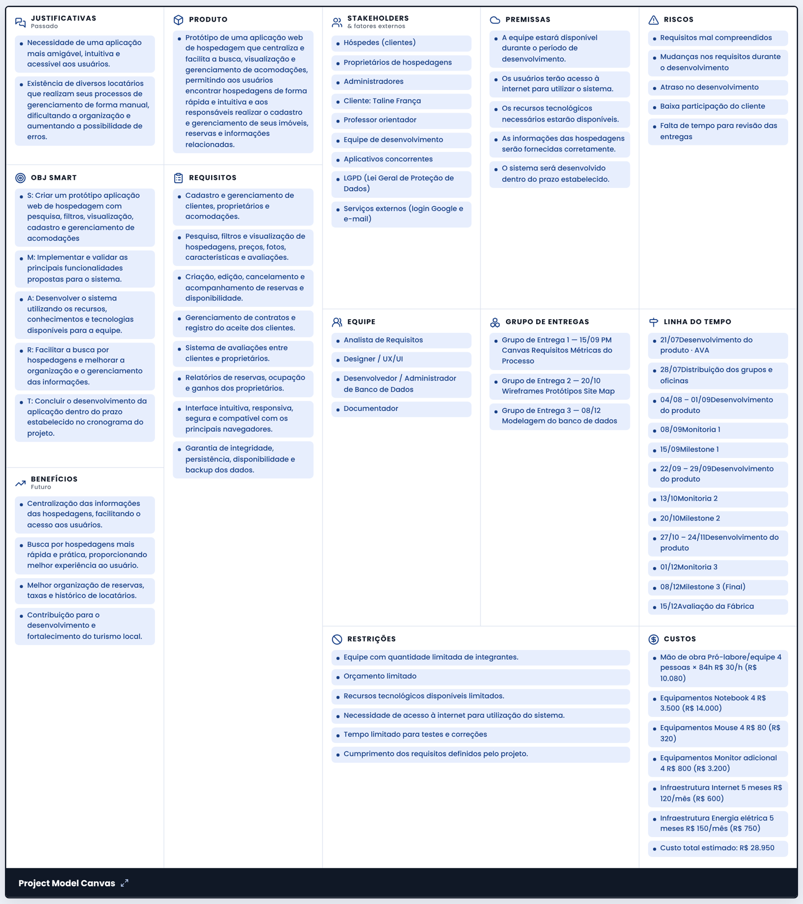

## Justificativa

* Necessidade de uma aplicação de hospedagem mais amigável, intuitiva e acessível aos usuários.
* Existência de diversos locatários que gerenciam seus processos de forma manual, o que dificulta a organização e aumenta a possibilidade de erros.

## Objetivo SMART

| | OBJETIVO |
|:---:|:---|
| **S** (específico) | Criar um protótipo de aplicação web de hospedagem com pesquisa, filtros, visualização, cadastro e gerenciamento de acomodações. |
| **M** (mensurável) | Implementar e validar as principais funcionalidades propostas para o sistema. |
| **A** (atingível) | Desenvolver o sistema com os recursos, conhecimentos e tecnologias disponíveis para a equipe. |
| **R** (relevante) | Facilitar a busca por hospedagens e melhorar a organização e o gerenciamento das informações. |
| **T** (temporal) | Concluir o desenvolvimento dentro do prazo do cronograma do projeto (08/12/2026). |

## Benefícios

* Centralização das informações das hospedagens, facilitando o acesso dos usuários.
* Busca por hospedagens mais rápida e prática, com melhor experiência para o usuário.
* Melhor organização de reservas, taxas e histórico de locatários.
* Contribuição para o desenvolvimento e o fortalecimento do turismo local.

## Demais blocos do Canvas

| BLOCO | RESUMO |
|:---|:---|
| Produto | Protótipo de aplicação web que centraliza a busca, a visualização e o gerenciamento de acomodações, reservas e informações relacionadas. |
| Stakeholders e fatores externos | Hóspedes (clientes), proprietários de hospedagens, administradores, a cliente Taline França, o professor orientador, a equipe de desenvolvimento e aplicativos concorrentes. Como fatores externos, a LGPD e os serviços externos de login Google e envio de e-mail. |
| Equipe | Analista de requisitos, designer UX/UI, desenvolvedor e administrador de banco de dados, e documentador. |
| Premissas | Equipe disponível durante o projeto, usuários com acesso à internet, recursos tecnológicos disponíveis e informações das hospedagens fornecidas corretamente. |
| Riscos | Requisitos mal compreendidos, mudanças nos requisitos, atraso no desenvolvimento, baixa participação da cliente e falta de tempo para revisão das entregas. |
| Restrições | Equipe pequena, orçamento e recursos tecnológicos limitados, dependência de internet, pouco tempo para testes e cumprimento dos requisitos definidos. |
| Entregas | Milestone 1 (15/09): PM Canvas, requisitos e métricas · Milestone 2 (20/10): wireframes, protótipos e site map · Milestone 3 (08/12): modelagem do banco de dados. |
| Custos | Custo total estimado de R$ 28.950: mão de obra (4 pessoas × 84 h × R$ 30/h = R$ 10.080), equipamentos (notebooks, mouses e monitores = R$ 17.520) e infraestrutura (internet e energia = R$ 1.350). |

## Alterações em relação à primeira versão

Na revisão feita no Milestone 3, o Canvas recebeu as seguintes correções:

* Remoção do item de custo "Equipamentos – Mouse", que estava duplicado.
* Correção do custo total estimado, de R$ 30.050 para R$ 28.950, conforme a soma dos itens.
* Correção de erros de digitação nos blocos Produto, Objetivo SMART e Premissas.
* Revisão dos stakeholders: separação entre a cliente (Taline França) e o professor orientador, troca de "Hóspedes/Usuários" por "Hóspedes (clientes)" e inclusão da LGPD e dos serviços externos (login Google e e-mail) como fatores externos.

[ [INÍCIO](#projeto-de-software) ]

# METODOLOGIA ADOTADA NO DESENVOLVIMENTO

A equipe utiliza o método **Kanban**, acompanhando o progresso por meio das métricas de Throughput, Lead Time e Cycle Time. O protótipo das telas foi desenvolvido no **Figma**.

## Planejamento por marcos

O trabalho é registrado como issues no GitLab, organizadas em três marcos:

| MARCO | PERÍODO | ENTREGAS | ISSUES | SITUAÇÃO |
|:---|:---|:---|:---:|:---|
| Milestone 1 | 21/07 a 15/09/2026 | PM Canvas, requisitos funcionais e não funcionais, histórias de usuário | 40 | Concluído |
| Milestone 2 | 16/09 a 20/10/2026 | Modelagem do banco de dados, diagramas UML e protótipos | 8 | Concluído |
| Milestone 3 (Final) | 21/10 a 08/12/2026 | Ajustes do banco de dados e documentação do projeto | 2 | Em andamento |

## Métricas

**Issues no GitLab** (dados de 10/11/2026): 50 issues, 48 fechadas e 2 abertas (96% concluídas).

| RESPONSÁVEL | ISSUES |
|:---|:---:|
| Thalita Peronico | 20 |
| Leticia Almeida | 13 |
| Ana Moura | 11 |
| Ana Funari | 6 |

### Milestone 1 (21/07 a 15/09/2026)

Métricas obtidas no painel FSBoard (dashboard.fslab.dev), a partir do quadro de issues do GitLab:

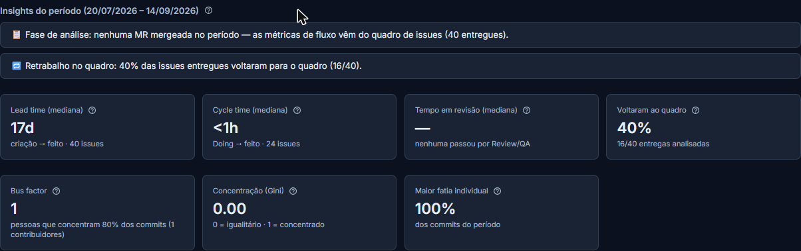

| MÉTRICA | VALOR |
|:---|:---|
| Issues entregues | 40 |
| Throughput | 40 issues entregues na semana 37 (07/09 a 13/09) |
| Lead time (mediana, criação → feito) | 17 dias |
| Lead time P85 | 20,1 dias |
| Cycle time (mediana, Doing → feito) | menos de 1 hora (24 issues) |
| Tempo em revisão | nenhuma issue passou por Review/QA |
| Retrabalho (voltaram ao quadro) | 40% (16 de 40) |

Distribuição do lead time: 31 issues entre 10 e 20 dias e 9 acima de 20 dias.

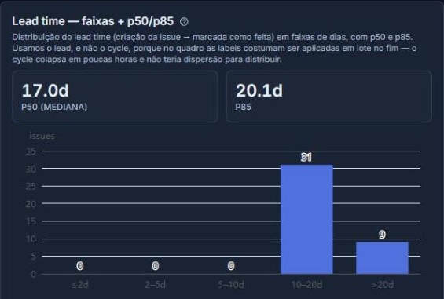

**Análise:** todas as entregas do Milestone 1 foram concluídas na mesma semana, perto do prazo, o que explica o lead time alto (17 dias) e concentrado. O cycle time abaixo de 1 hora mostra que as issues eram movidas para Doing e para concluído quase ao mesmo tempo, ou seja, o quadro não acompanhava o andamento real do trabalho. Nenhuma issue passou pela coluna Review, e 40% voltaram ao quadro depois de entregues. A partir disso, a equipe passou a mover as issues no quadro conforme o trabalho avança e a usar a coluna Review antes de concluir.

### Milestone 2 (16/09 a 20/10/2026)

**Fluxo Kanban no Milestone 2** (8 itens concluídos, apresentado em 20/10/2026):

| MÉTRICA | VALOR |
|:---|:---|
| Lead Time (mediana, To Do → Done) | 181,8 h (faixa: 34,8 h a 498,4 h) |
| Cycle Time (mediana, Doing → Done) | 181,8 h (faixa: 34,8 h a 498,1 h) |
| Cycle Time P50 | 7,6 dias |
| Cycle Time P85 | 20,7 dias |

Distribuição do Cycle Time: 3 itens em até 2 dias, 2 itens entre 5 e 10 dias e 3 itens acima de 20 dias.

## Dificuldades e aprendizados

| DIFICULDADES | APRENDIZADOS |
|:---|:---|
| Distribuição de tarefas | Alinhar a disponibilidade logo no início |
| Disponibilidade limitada dos membros | Fazer acompanhamentos curtos e frequentes |
| Prazo curto | Dividir as tarefas de acordo com a disponibilidade |
| Volume grande de documentação | Planejar o tempo por tipo de entrega |


# Requisitos do Software

A especificação dos requisitos deste documento segue as recomendações da norma IEEE Std-830-1998, levando em conta as recomendações do documento de [características dos requisitos](caracteristicas_requisitos.md).

## Minimundo

Uma plataforma de hospedagem por temporada conecta proprietários de imóveis (casas, apartamentos, chalés, pousadas e similares) a clientes que desejam se hospedar por períodos curtos. Hoje, o controle de disponibilidade, preços por período, reservas, pagamentos e avaliações é feito de forma manual, por mensagens e planilhas, o que dificulta a organização e o controle das informações.

Para resolver esse problema, será desenvolvido um website que armazena as informações de usuários, clientes, proprietários, endereços, hospedagens, fotos, comodidades, preços por período, cupons de desconto, reservas, pagamentos e avaliações. O sistema permitirá cadastrar e publicar hospedagens, registrar reservas, aplicar cupons, registrar pagamentos com formas combinadas, receber avaliações e gerar relatórios de reservas.

## Requisitos Funcionais

Os requisitos RF-001 a RF-010 foram elicitados no Milestone 1, por entrevista com a cliente. Os requisitos RF-011 a RF-014 foram identificados durante a modelagem do banco de dados (Milestone 2) e incorporados à especificação no Milestone 3.

| IDENTIFICADOR | NOME | DESCRIÇÃO | PRIORIDADE | ORIGEM |
| :--- | :--- | :--- | :--- | :--- |
| **RF-001** | Cadastro e manutenção de usuários | O sistema deve permitir o cadastro de usuário com e-mail e senha ou conta Google, com perfil de cliente e/ou de proprietário, a exclusão da conta e a alteração dos dados cadastrais: nome completo, CPF (ou CNPJ, para proprietário), data de nascimento (cliente), celular e endereço. | Essencial | Entrevista (#4) |
| **RF-002** | Autenticação de usuários | O sistema deve permitir o acesso com e-mail e senha ou com conta Google, e a recuperação de senha por um código de 5 caracteres enviado ao e-mail, com prazo de validade e uso único. | Essencial | Entrevista (#6) |
| **RF-003** | Cadastro e manutenção de acomodações | O sistema deve permitir que o proprietário cadastre, altere e exclua hospedagens (dados do imóvel, endereço, regras, horários, valores, fotos ordenadas e comodidades), defina preços por período e publique a hospedagem, que fica como rascunho até ser publicada. | Essencial | Entrevista (#11) |
| **RF-004** | Consulta de acomodações | O sistema deve permitir que qualquer pessoa pesquise hospedagens publicadas por cidade, período e número de hóspedes, com filtros de preço, avaliação, tipo e comodidades, e consulte os detalhes de cada uma (fotos, descrição, comodidades, regras, preços e avaliações). | Essencial | Entrevista (#7) |
| **RF-005** | Solicitação de reserva | O sistema deve permitir que o cliente solicite uma reserva informando check-in, check-out e número de hóspedes, verificando a disponibilidade do período, calculando o valor total conforme o preço por noite de cada período e aplicando cupom de desconto ativo e válido. | Essencial | Entrevista (#15) |
| **RF-006** | Ciclo da reserva | O sistema deve controlar a situação da reserva (pendente, confirmada, concluída e cancelada) e permitir apenas as transições válidas entre situações. | Essencial | Entrevista (#18) |
| **RF-007** | Reservas do proprietário | O sistema deve permitir que o proprietário consulte as reservas recebidas em suas hospedagens e atualize a situação de cada uma. | Essencial | Entrevista (#17) |
| **RF-008** | Reservas do cliente | O sistema deve permitir que o cliente consulte suas reservas, com hospedagem, período, valor e situação. | Essencial | Entrevista (#8) |
| **RF-009** | Cancelamento de reserva | O sistema deve permitir que o cliente cancele uma reserva ainda não concluída, liberando o período na hospedagem. | Essencial | Entrevista (#10) |
| **RF-010** | Avaliações | O sistema deve permitir que, após a hospedagem concluída, o cliente avalie a hospedagem (notas de 1 a 5 para geral, limpeza, conforto, atendimento e custo-benefício) e o proprietário avalie o cliente (notas de 1 a 5 para geral, comunicação, pontualidade, respeito às regras e cuidado com o imóvel), uma única vez por reserva, com comentário opcional. | Essencial | Entrevista (#14) |
| **RF-011** | Pagamento da reserva | O sistema deve registrar o pagamento da reserva, permitindo combinar mais de uma forma de pagamento, com valor pago, data e situação de cada pagamento. | Essencial | Modelagem do BD |
| **RF-012** | Preferências do cliente | O sistema deve permitir que o cliente registre suas preferências de hospedagem. | Opcional | Modelagem do BD |
| **RF-013** | Gestão de cupons | O sistema deve permitir que o administrador cadastre cupons de desconto com código único, tipo, valor e validade, e os ative ou desative. | Condicional | Modelagem do BD |
| **RF-014** | Relatórios de reservas | O sistema deve permitir que o proprietário consulte relatórios das reservas de suas hospedagens e que o administrador consulte relatórios de todas as reservas da plataforma. | Condicional | Modelagem do BD |


## Requisitos Não Funcionais

Os requisitos RNF-001 a RNF-004 foram elicitados no Milestone 1. Os requisitos RNF-005 a RNF-008 vieram da modelagem do banco de dados e foram reescritos de forma verificável.

| IDENTIFICADOR | NOME | DESCRIÇÃO | ORIGEM |
|:---|:---|:---|:---|
| RNF-001 | Proteção dos dados pessoais | As senhas devem ser armazenadas com hash, e o tratamento de dados pessoais (CPF, CNPJ, e-mail e celular) deve seguir a LGPD (Lei nº 13.709/2018). | Entrevista (#19) |
| RNF-002 | Controle de acesso por perfil | Cada funcionalidade só pode ser executada pelo perfil autorizado: o cliente acessa apenas as próprias reservas; o proprietário, apenas as próprias hospedagens e as reservas recebidas nelas; e o administrador, as funções de gestão da plataforma. | Entrevista (#39) |
| RNF-003 | Integridade dos dados das reservas | O sistema não deve permitir duas reservas ativas para a mesma hospedagem em períodos sobrepostos. | Entrevista (#42) |
| RNF-004 | Rastreabilidade das alterações | O sistema deve registrar as alterações relevantes, como mudanças na situação da reserva, com data, hora e usuário responsável. | Entrevista (#43) |
| RNF-005 | Usabilidade | O usuário deve conseguir concluir uma reserva, a partir da página da hospedagem, em no máximo 5 passos. | Modelagem do BD |
| RNF-006 | Desempenho | 95% das buscas de hospedagens devem retornar resultados em até 3 segundos. | Modelagem do BD |
| RNF-007 | Compatibilidade | O sistema deve funcionar nas versões atuais do Chrome, Firefox, Edge e Safari, com layout responsivo para celulares, tablets e computadores. | Modelagem do BD |
| RNF-008 | Normalização do banco de dados | O banco de dados deve seguir a 3ª Forma Normal. | Modelagem do BD |


## Rastreabilidade com as versões anteriores

Os requisitos atuais consolidam duas versões anteriores: a lista RF01–RF10, registrada nas issues do GitLab, e a lista RF01–RF18, do documento do banco de dados. A tabela a seguir indica onde cada requisito antigo está contemplado.

| VERSÃO ANTERIOR | REQUISITO ANTIGO | REQUISITO ATUAL |
|:---|:---|:---|
| GitLab | RF01 – Cadastro e manutenção de usuários | RF-001 |
| GitLab | RF02 – Autenticação | RF-002 |
| GitLab | RF03 – Cadastro e manutenção de acomodações | RF-003 |
| GitLab | RF04 – Consulta de acomodações | RF-004 |
| GitLab | RF05 – Solicitação de reserva | RF-005 |
| GitLab | RF06 – Ciclo da reserva | RF-006 |
| GitLab | RF07 – Reservas do proprietário | RF-007 |
| GitLab | RF08 – Reservas do cliente | RF-008 |
| GitLab | RF09 – Cancelamento de reservas | RF-009 |
| GitLab | RF10 – Avaliações | RF-010 |
| Banco de dados | RF01 – Cadastrar usuário | RF-001 |
| Banco de dados | RF02 – Autenticar (e-mail/senha ou Google) | RF-002 |
| Banco de dados | RF03 – Recuperar senha | RF-002 |
| Banco de dados | RF04 – Cadastrar e alterar endereço | RF-001 (usuário), RF-003 (hospedagem) |
| Banco de dados | RF05 – Cadastrar hospedagem (fotos ordenadas e comodidades) | RF-003 |
| Banco de dados | RF06 – Definir preços por período | RF-003 |
| Banco de dados | RF07 – Publicar hospedagem | RF-003 |
| Banco de dados | RF08 – Gerenciar cupons (ativar/desativar) | RF-013 |
| Banco de dados | RF09 – Registrar preferências do cliente | RF-012 |
| Banco de dados | RF10 – Consultar e buscar hospedagens | RF-004 |
| Banco de dados | RF11 – Registrar reserva | RF-005 |
| Banco de dados | RF12 – Aplicar cupom | RF-005 |
| Banco de dados | RF13 – Registrar pagamento combinado | RF-011 |
| Banco de dados | RF14 – Registrar avaliação | RF-010 |
| Banco de dados | RF15 – Consultar reservas realizadas | RF-007, RF-008 |
| Banco de dados | RF16 – Gerar relatórios | RF-014 |
| Banco de dados | RF17 – Alterar dados cadastrais | RF-001 |
| Banco de dados | RF18 – Excluir registros | RF-001, RF-003 |


## Regras de Negócio

| IDENTIFICADOR | REGRA |
|:---|:---|
| RN-001 | Um usuário acessa o sistema por e-mail e senha ou pela conta Google. |
| RN-002 | Um usuário pode ter perfil de cliente, de proprietário ou os dois. |
| RN-003 | Um usuário pode solicitar várias recuperações de senha; cada uma tem código próprio, prazo de validade e controle de uso. |
| RN-004 | O proprietário deve informar CPF ou CNPJ. |
| RN-005 | Um proprietário pode cadastrar várias hospedagens, e cada hospedagem pertence a um único proprietário. |
| RN-006 | Cliente, proprietário e hospedagem possuem, cada um, um único endereço. Um endereço tem um único CEP, e um CEP pertence a uma única cidade. |
| RN-007 | Uma hospedagem pode ter várias fotos, exibidas em ordem definida pelo proprietário. |
| RN-008 | Uma hospedagem pode oferecer várias comodidades, e uma comodidade pode estar em várias hospedagens. |
| RN-009 | Uma hospedagem pode ter vários períodos com preço por noite diferenciado. |
| RN-010 | Toda hospedagem começa como rascunho e só aparece nas buscas depois de publicada pelo proprietário. |
| RN-011 | Um cliente pode escolher várias preferências, e uma preferência pode ser escolhida por vários clientes. |
| RN-012 | Uma reserva pertence a um único cliente e a uma única hospedagem; um cliente e uma hospedagem podem ter várias reservas. |
| RN-013 | Não pode haver duas reservas ativas para a mesma hospedagem em períodos sobrepostos. |
| RN-014 | O valor total da reserva é calculado pelo preço por noite de cada período, somado à taxa de limpeza e descontado o cupom. |
| RN-015 | Uma reserva pode usar no máximo um cupom; um cupom tem código único, pode ser usado em várias reservas e precisa estar ativo e dentro da validade. |
| RN-016 | Uma reserva pode ser paga com várias formas de pagamento combinadas. |
| RN-017 | Cada reserva pode ter no máximo uma avaliação da hospedagem (feita pelo cliente) e uma avaliação do cliente (feita pelo proprietário), apenas após a hospedagem concluída. |
| RN-018 | As notas das avaliações vão de 1 a 5. |


## User Stories

As 25 histórias de usuário foram elaboradas no Milestone 1 e estão registradas como issues no GitLab (US-001 a US-025). Cada história segue o formato "Como [perfil], quero [ação], para [benefício]" e tem critérios de aceitação no formato Dado / Quando / Então.

### Resumo das histórias

| ID | HISTÓRIA | PERFIL | REQUISITOS |
|:---|:---|:---|:---|
| US-001 | Cadastrar cliente | cliente | RF-001 |
| US-002 | Cadastrar proprietário | proprietário | RF-001 |
| US-003 | Atualizar dados cadastrais | usuário cadastrado | RF-001 |
| US-004 | Entrar na plataforma | cliente ou proprietário cadastrado | RF-002 |
| US-005 | Acessar funcionalidades conforme o perfil | usuário autenticado | RF-002, RNF-002 |
| US-006 | Cadastrar acomodação | proprietário | RF-003 |
| US-007 | Atualizar acomodação | proprietário | RF-003 |
| US-008 | Adicionar e atualizar fotos | proprietário | RF-003 |
| US-009 | Definir preço por período | proprietário | RF-003 |
| US-010 | Informar disponibilidade da acomodação | proprietário | RF-003, RNF-003 |
| US-011 | Pesquisar acomodações | cliente | RF-004 |
| US-012 | Filtrar acomodações | cliente | RF-004 |
| US-013 | Visualizar detalhes da acomodação | cliente | RF-004 |
| US-014 | Solicitar reserva | cliente | RF-005 |
| US-015 | Impedir reservas conflitantes | cliente | RF-005, RNF-003 |
| US-016 | Acompanhar situação da reserva | cliente | RF-006, RF-008 |
| US-017 | Atualizar situação da reserva | proprietário | RF-006, RF-007 |
| US-018 | Consultar reservas das acomodações | proprietário | RF-007 |
| US-019 | Consultar minhas reservas | cliente | RF-008 |
| US-020 | Cancelar reserva | cliente | RF-009 |
| US-021 | Avaliar hospedagem | cliente | RF-010 |
| US-022 | Consultar avaliações | cliente | RF-004, RF-010 |
| US-023 | Avaliar hóspede | proprietário | RF-010 |
| US-024 | Restringir acesso aos dados pessoais | usuário da plataforma | RNF-001, RNF-002 |
| US-025 | Registrar alterações | proprietário | RNF-004 |

### US-001 — Cadastrar cliente

**Como** cliente, **quero** criar uma conta na plataforma, **para** utilizar as funcionalidades disponíveis para clientes.

**Requisitos relacionados:** RF-001

**Critérios de aceitação:**

```gherkin
Cenário 1
  Dado que estou na tela de cadastro
  Quando informo os dados obrigatórios válidos
  Então minha conta de cliente é criada
  E posso acessar as funcionalidades destinadas aos clientes

Cenário 2
  Dado que estou preenchendo o cadastro
  Quando deixo um campo obrigatório sem preenchimento
  Então o sistema informa o campo que precisa ser preenchido
  E não conclui o cadastro
```

### US-002 — Cadastrar proprietário

**Como** proprietário, **quero** criar uma conta na plataforma, **para** cadastrar e administrar minhas acomodações.

**Requisitos relacionados:** RF-001

**Critérios de aceitação:**

```gherkin
Cenário 1
  Dado que estou na tela de cadastro
  Quando informo os dados obrigatórios válidos e seleciono o perfil de proprietário
  Então minha conta de proprietário é criada
  E posso acessar as funcionalidades destinadas ao proprietário

Cenário 2
  Dado que estou preenchendo o cadastro
  Quando informo dados obrigatórios inválidos
  Então o sistema informa os dados que precisam ser corrigidos
  E não conclui o cadastro
```

### US-003 — Atualizar dados cadastrais

**Como** usuário cadastrado, **quero** atualizar meus dados cadastrais, **para** manter minhas informações atualizadas.

**Requisitos relacionados:** RF-001

**Critérios de aceitação:**

```gherkin
Cenário 1
  Dado que estou autenticado
  Quando altero meus dados cadastrais com informações válidas
  Então os novos dados são salvos
  E passam a ser apresentados no meu cadastro

Cenário 2
  Dado que estou editando meus dados
  Quando informo dados inválidos
  Então o sistema informa o problema
  E não salva a alteração
```

### US-004 — Entrar na plataforma

**Como** cliente ou proprietário cadastrado, **quero** entrar na minha conta, **para** acessar as funcionalidades disponíveis para meu perfil.

**Requisitos relacionados:** RF-002

**Critérios de aceitação:**

```gherkin
Cenário 1
  Dado que possuo uma conta cadastrada
  Quando informo minhas credenciais válidas
  Então o sistema permite meu acesso
  E apresenta as funcionalidades correspondentes ao meu perfil

Cenário 2
  Dado que estou na tela de login
  Quando informo credenciais inválidas
  Então o sistema informa que não foi possível realizar a autenticação
  E não permite o acesso à conta
```

### US-005 — Acessar funcionalidades conforme o perfil

**Como** usuário autenticado, **quero** acessar somente as funcionalidades permitidas para meu perfil, **para** utilizar o sistema de acordo com minhas permissões.

**Requisitos relacionados:** RF-002, RNF-002

**Critérios de aceitação:**

```gherkin
Cenário 1
  Dado que estou autenticado como proprietário
  Quando acesso a plataforma
  Então o sistema disponibiliza as funcionalidades destinadas ao proprietário

Cenário 2
  Dado que estou autenticado como cliente
  Quando tento acessar uma funcionalidade exclusiva de proprietário
  Então o sistema impede o acesso
```

### US-006 — Cadastrar acomodação

**Como** proprietário, **quero** cadastrar uma acomodação, **para** disponibilizá-la para hospedagem.

**Requisitos relacionados:** RF-003

**Critérios de aceitação:**

```gherkin
Cenário 1
  Dado que estou autenticado como proprietário
  Quando cadastro uma acomodação com as informações obrigatórias válidas
  Então a acomodação é registrada
  E fica disponível conforme as regras definidas

Cenário 2
  Dado que estou cadastrando uma acomodação
  Quando deixo uma informação obrigatória sem preenchimento
  Então o sistema informa o campo que precisa ser preenchido
  E não conclui o cadastro
```

### US-007 — Atualizar acomodação

**Como** proprietário, **quero** alterar as informações da minha acomodação, **para** mantê-las atualizadas para os clientes.

**Requisitos relacionados:** RF-003

**Critérios de aceitação:**

```gherkin
Cenário 1
  Dado que possuo uma acomodação cadastrada
  Quando altero suas informações com dados válidos
  Então o sistema salva as alterações
  E apresenta as informações atualizadas

Cenário 2
  Dado que estou alterando uma acomodação
  Quando informo dados inválidos
  Então o sistema informa o problema
  E não salva a alteração
```

### US-008 — Adicionar e atualizar fotos

**Como** proprietário, **quero** adicionar e atualizar fotos da minha acomodação, **para** apresentar o espaço aos clientes.

**Requisitos relacionados:** RF-003

**Critérios de aceitação:**

```gherkin
Cenário 1
  Dado que possuo uma acomodação cadastrada
  Quando adiciono uma imagem aceita pelo sistema
  Então a imagem fica vinculada à acomodação
  E pode ser visualizada pelos clientes

Cenário 2
  Dado que estou adicionando uma imagem
  Quando o arquivo não atende aos critérios aceitos pelo sistema
  Então a imagem não é adicionada
  E o sistema informa o problema
```

### US-009 — Definir preço por período

**Como** proprietário, **quero** cadastrar e atualizar preços para diferentes períodos, **para** disponibilizar aos clientes os valores das hospedagens.

**Requisitos relacionados:** RF-003

**Critérios de aceitação:**

```gherkin
Cenário 1
  Dado que possuo uma acomodação cadastrada
  Quando cadastro um preço para um período válido
  Então o preço fica associado à acomodação e ao período informado

Cenário 2
  Dado que estou cadastrando ou alterando um preço
  Quando informo um valor ou período inválido
  Então o sistema informa o problema
  E não salva a informação incorreta
```

### US-010 — Informar disponibilidade da acomodação

**Como** proprietário, **quero** informar períodos disponíveis e indisponíveis da minha acomodação, **para** controlar quando ela poderá receber reservas.

**Requisitos relacionados:** RF-003, RNF-003

**Critérios de aceitação:**

```gherkin
Cenário 1
  Dado que possuo uma acomodação cadastrada
  Quando informo um período como indisponível
  Então o período passa a ser identificado como indisponível
  E não pode ser utilizado para uma nova reserva

Cenário 2
  Dado que tento bloquear um período que possui uma situação conflitante
  Quando confirmo o bloqueio
  Então o sistema informa o conflito
  E não realiza a alteração sem atender à regra definida
```

### US-011 — Pesquisar acomodações

**Como** cliente, **quero** pesquisar acomodações considerando o período desejado, **para** encontrar opções disponíveis para minha hospedagem.

**Requisitos relacionados:** RF-004

**Critérios de aceitação:**

```gherkin
Cenário 1
  Dado que existem acomodações disponíveis para o período informado
  Quando realizo a pesquisa
  Então o sistema apresenta as acomodações disponíveis

Cenário 2
  Dado que nenhuma acomodação está disponível no período informado
  Quando realizo a pesquisa
  Então o sistema informa que não foram encontradas acomodações disponíveis
```

### US-012 — Filtrar acomodações

**Como** cliente, **quero** filtrar as acomodações utilizando características disponíveis, **para** encontrar opções compatíveis com minhas necessidades.

**Requisitos relacionados:** RF-004

**Critérios de aceitação:**

```gherkin
Cenário 1
  Dado que existem várias acomodações disponíveis
  Quando aplico um filtro disponível no sistema
  Então o sistema apresenta somente as acomodações compatíveis

Cenário 2
  Dado que nenhuma acomodação atende ao filtro
  Quando aplico o filtro
  Então o sistema informa que nenhuma acomodação foi encontrada
  E disponibiliza uma opção para remover o filtro
```

### US-013 — Visualizar detalhes da acomodação

**Como** cliente, **quero** visualizar os detalhes de uma acomodação, **para** conhecer o local antes de solicitar uma reserva.

**Requisitos relacionados:** RF-004

**Critérios de aceitação:**

```gherkin
Cenário 1
  Dado que uma acomodação está disponível para consulta
  Quando acesso seus detalhes
  Então visualizo suas informações
  E consigo consultar características, regras, fotos, preços e disponibilidade

Cenário 2
  Dado que uma acomodação não está disponível para novas reservas
  Quando acesso seus detalhes
  Então o sistema informa que ela não pode ser reservada
```

### US-014 — Solicitar reserva

**Como** cliente, **quero** solicitar uma reserva informando o período desejado, **para** reservar uma acomodação disponível.

**Requisitos relacionados:** RF-005

**Critérios de aceitação:**

```gherkin
Cenário 1
  Dado que uma acomodação está disponível no período escolhido
  Quando solicito a reserva
  Então o sistema registra a solicitação
  E associa a reserva ao cliente, à acomodação e ao período informado

Cenário 2
  Dado que o período escolhido não está disponível
  Quando tento solicitar a reserva
  Então o sistema recusa a solicitação
  E informa que o período não está disponível
```

### US-015 — Impedir reservas conflitantes

**Como** cliente, **quero** que o sistema impeça reservas conflitantes, **para** evitar que uma acomodação seja reservada por mais de um cliente no mesmo período.

**Requisitos relacionados:** RF-005, RNF-003

**Critérios de aceitação:**

```gherkin
Cenário 1
  Dado que uma acomodação possui uma reserva para determinado período
  Quando solicito uma nova reserva para um período conflitante
  Então o sistema impede o registro
  E informa que a acomodação está indisponível

Cenário 2
  Dado que o período solicitado não possui conflito
  Quando solicito a reserva
  Então a solicitação pode prosseguir conforme o fluxo definido
```

### US-016 — Acompanhar situação da reserva

**Como** cliente, **quero** acompanhar a situação da minha reserva, **para** saber em qual etapa está minha hospedagem.

**Requisitos relacionados:** RF-006, RF-008

**Critérios de aceitação:**

```gherkin
Cenário 1
  Dado que possuo uma reserva registrada
  Quando consulto seus dados
  Então visualizo a situação atual da reserva

Cenário 2
  Dado que a reserva ainda não avançou para a próxima etapa
  Quando consulto a reserva
  Então o sistema apresenta somente a situação atual
```

### US-017 — Atualizar situação da reserva

**Como** proprietário, **quero** atualizar a situação da reserva conforme as etapas permitidas, **para** manter o processo de hospedagem atualizado.

**Requisitos relacionados:** RF-006, RF-007

**Critérios de aceitação:**

```gherkin
Cenário 1
  Dado que existe uma reserva em uma etapa que permite determinada alteração
  Quando realizo a ação correspondente
  Então o sistema atualiza a situação conforme o fluxo definido

Cenário 2
  Dado que tento realizar uma alteração não permitida para a situação atual
  Quando solicito a alteração
  Então o sistema recusa a operação
  E mantém a situação anterior
```

### US-018 — Consultar reservas das acomodações

**Como** proprietário, **quero** consultar as reservas das minhas acomodações, **para** acompanhar as hospedagens agendadas.

**Requisitos relacionados:** RF-007

**Critérios de aceitação:**

```gherkin
Cenário 1
  Dado que existem reservas relacionadas às minhas acomodações
  Quando acesso a consulta de reservas
  Então visualizo as reservas correspondentes

Cenário 2
  Dado que não existem reservas relacionadas às minhas acomodações
  Quando acesso a consulta
  Então o sistema informa que não existem reservas registradas
```

### US-019 — Consultar minhas reservas

**Como** cliente, **quero** consultar minhas reservas, **para** acompanhar minhas hospedagens e suas situações.

**Requisitos relacionados:** RF-008

**Critérios de aceitação:**

```gherkin
Cenário 1
  Dado que possuo reservas registradas
  Quando acesso minhas reservas
  Então visualizo as reservas vinculadas à minha conta
  E consigo identificar a situação de cada uma

Cenário 2
  Dado que não possuo reservas
  Quando acesso a consulta
  Então o sistema informa que não existem reservas registradas
```

### US-020 — Cancelar reserva

**Como** cliente, **quero** cancelar uma reserva quando permitido, **para** desistir de uma hospedagem que não poderei realizar.

**Requisitos relacionados:** RF-009

**Critérios de aceitação:**

```gherkin
Cenário 1
  Dado que possuo uma reserva que pode ser cancelada conforme as regras definidas
  Quando solicito o cancelamento
  Então a reserva passa para a situação correspondente ao cancelamento
  E o período fica disponível conforme as regras do sistema

Cenário 2
  Dado que a reserva não pode ser cancelada na situação atual
  Quando solicito o cancelamento
  Então o sistema recusa a operação
  E informa o motivo
```

### US-021 — Avaliar hospedagem

**Como** cliente, **quero** avaliar uma hospedagem realizada, **para** registrar minha experiência.

**Requisitos relacionados:** RF-010

**Critérios de aceitação:**

```gherkin
Cenário 1
  Dado que minha hospedagem foi concluída
  Quando estou autorizado a realizar uma avaliação
  E registro minha avaliação
  Então ela fica associada à hospedagem correspondente

Cenário 2
  Dado que não estou autorizado a avaliar a hospedagem
  Quando tento registrar uma avaliação
  Então o sistema impede o registro
  E informa o motivo
```

### US-022 — Consultar avaliações

**Como** cliente, **quero** consultar as avaliações de uma acomodação, **para** conhecer a experiência de outros hóspedes.

**Requisitos relacionados:** RF-004, RF-010

**Critérios de aceitação:**

```gherkin
Cenário 1
  Dado que existem avaliações disponíveis para uma acomodação
  Quando acesso suas avaliações
  Então visualizo as avaliações que tenho permissão para consultar

Cenário 2
  Dado que uma acomodação não possui avaliações
  Quando acesso sua área de avaliações
  Então o sistema informa que ainda não existem avaliações disponíveis
```

### US-023 — Avaliar hóspede

**Como** proprietário, **quero** avaliar um hóspede após uma hospedagem, **para** registrar minha experiência como anfitrião.

**Requisitos relacionados:** RF-010

**Critérios de aceitação:**

```gherkin
Cenário 1
  Dado que a hospedagem foi concluída
  E o proprietário está autorizado a avaliar o hóspede
  Quando registro a avaliação
  Então ela fica associada ao hóspede e à hospedagem correspondente

Cenário 2
  Dado que o proprietário não está autorizado a realizar a avaliação
  Quando tenta registrar uma avaliação
  Então o sistema impede o registro
```

### US-024 — Restringir acesso aos dados pessoais

**Como** usuário da plataforma, **quero** que meus dados pessoais sejam acessíveis somente por usuários autorizados, **para** preservar a privacidade das minhas informações.

**Requisitos relacionados:** RNF-001, RNF-002

**Critérios de aceitação:**

```gherkin
Cenário 1
  Dado que estou autenticado e possuo permissão para acessar determinada informação
  Quando solicito essa informação
  Então o sistema permite o acesso conforme minha autorização

Cenário 2
  Dado que não possuo permissão para acessar determinada informação
  Quando tento acessá-la
  Então o sistema nega o acesso
  E não apresenta os dados protegidos
```

### US-025 — Registrar alterações

**Como** proprietário, **quero** que as alterações relevantes realizadas nas informações das minhas acomodações e reservas sejam registradas, **para** identificar o que foi alterado, por quem e quando.

**Requisitos relacionados:** RNF-004

**Critérios de aceitação:**

```gherkin
Cenário 1
  Dado que existe uma informação com rastreabilidade definida
  Quando realizo uma alteração nessa informação
  Então o sistema registra a alteração realizada
  E identifica o usuário responsável
  E registra a data e hora da operação

Cenário 2
  Dado que realizo uma alteração em uma informação que possui rastreabilidade definida
  Quando consulto o registro da alteração
  Então consigo identificar o usuário responsável
  E a data e hora da operação
```


## Pendências de consistência com o banco de dados

Os itens a seguir foram identificados ao comparar os requisitos com o [Dicionário de Dados](#dicionário-de-dados) e devem ser resolvidos na próxima revisão do banco:

| # | PENDÊNCIA | REQUISITOS AFETADOS |
|:---|:---|:---|
| 1 | Resolvida: a tabela RESERVA recebeu o campo RESE_DS_STATUS (PENDENTE, CONFIRMADA, CANCELADA e CONCLUIDA) ([issue #73](https://gitlab.fslab.dev/fabrica-de-software-i-2026/projeto5/-/issues/73)). | RF-006, RF-007, RF-008, RF-009 |
| 2 | Não há tabela de log para registrar as alterações relevantes com data, hora e usuário responsável. | RNF-004 |
| 3 | O campo `USUA_DS_TIPO` guarda um único perfil, mas a regra permite que o mesmo usuário seja cliente e proprietário. | RF-001, RN-002 |
| 4 | O perfil de administrador não está previsto no banco (`USUA_DS_TIPO` aceita apenas cliente ou proprietário). Perfil fora do escopo desta versão. | RF-013, RF-014, RNF-002 |
| 5 | Resolvida: o grupo decidiu não implementar o bloqueio manual de datas; a disponibilidade depende das reservas. | RF-003, RF-005 |


# Prototipagem

O protótipo das telas foi desenvolvido no Figma: [HERA — Protótipo](https://www.figma.com/design/Ap64svSqPkcBFoPZL0mJrf/Fabrica-I?node-id=0-1&p=f&t=wRyGjbrLVNiPLK7Z-0)

## Wireframes

Os wireframes foram elaborados no Figma e orientaram a criação do protótipo de alta fidelidade.

### Home

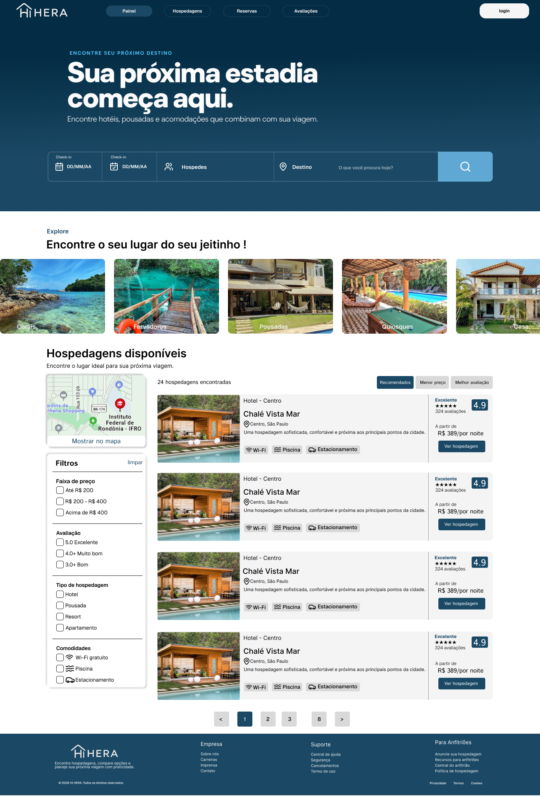

### Login


### Tipo de conta


### Cadastro de cliente

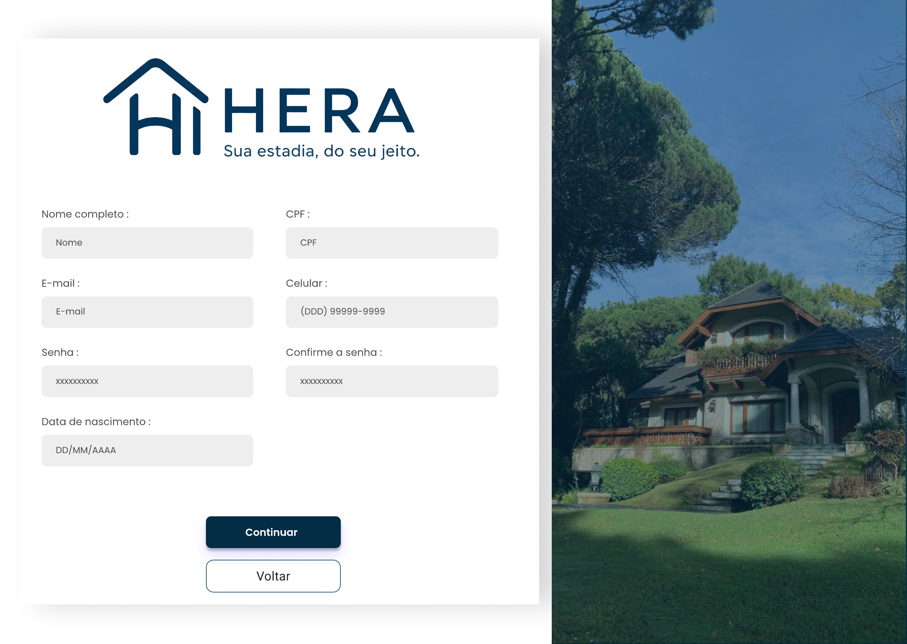

### Detalhe da hospedagem

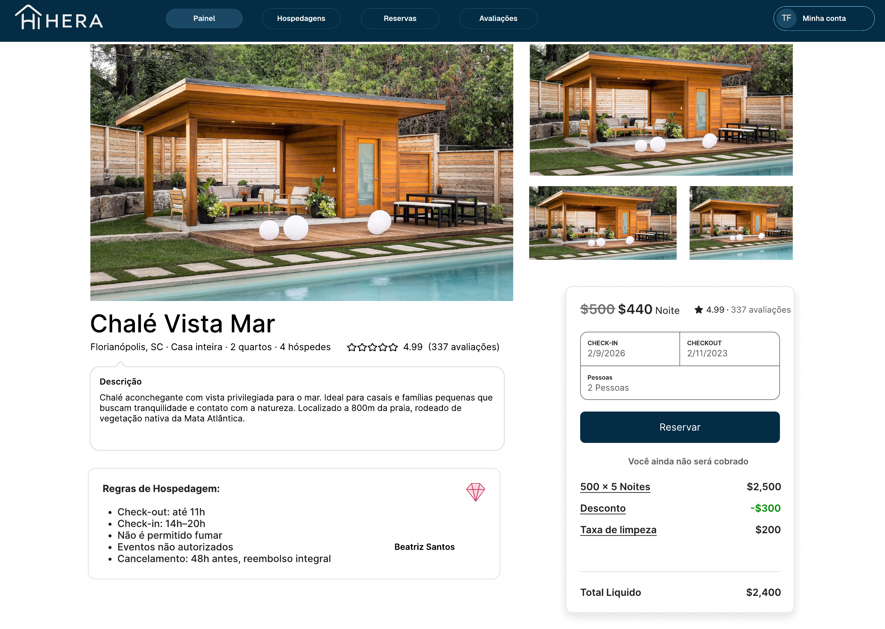

### Reserva – data

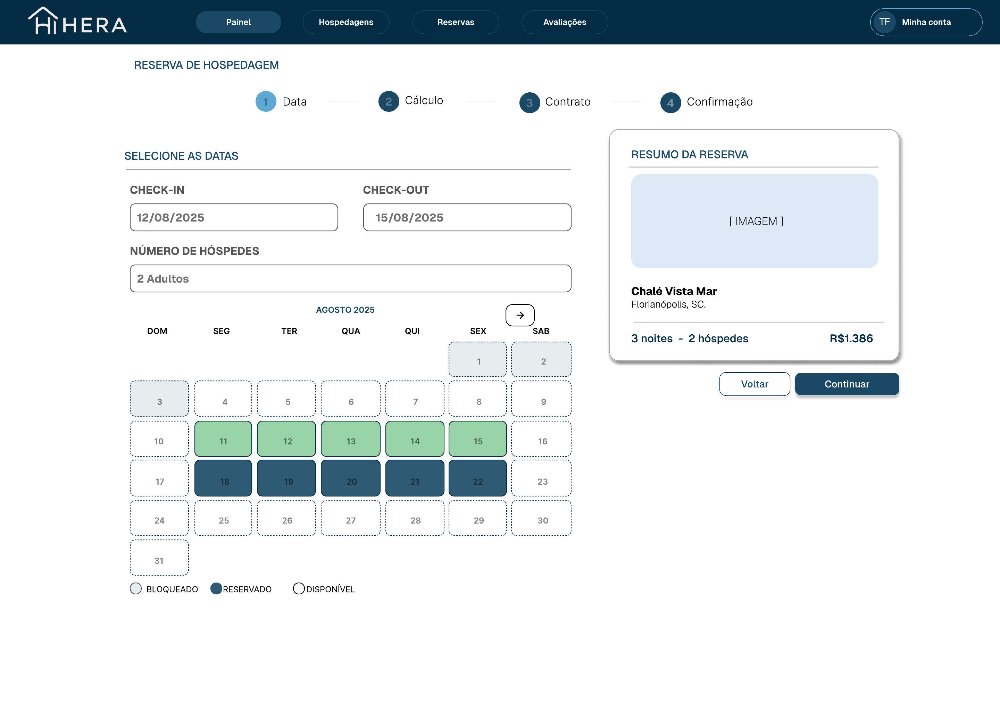

### Reserva – pagamento

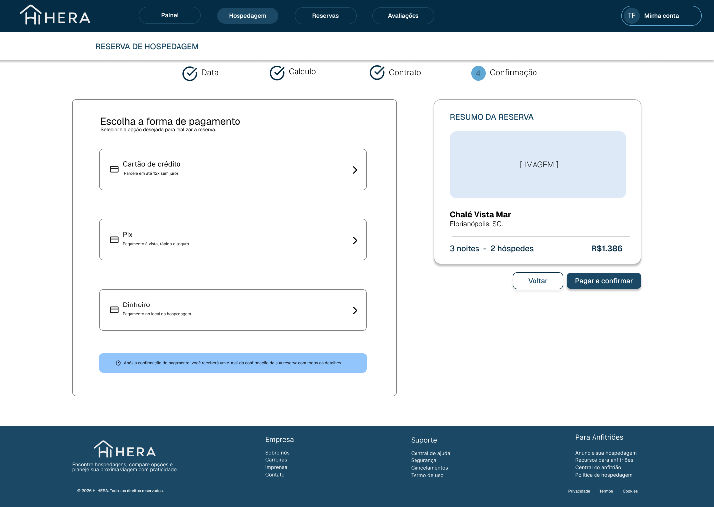

### Reserva confirmada

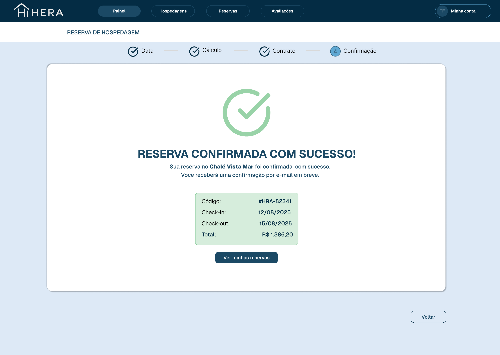

### Avaliar hospedagem

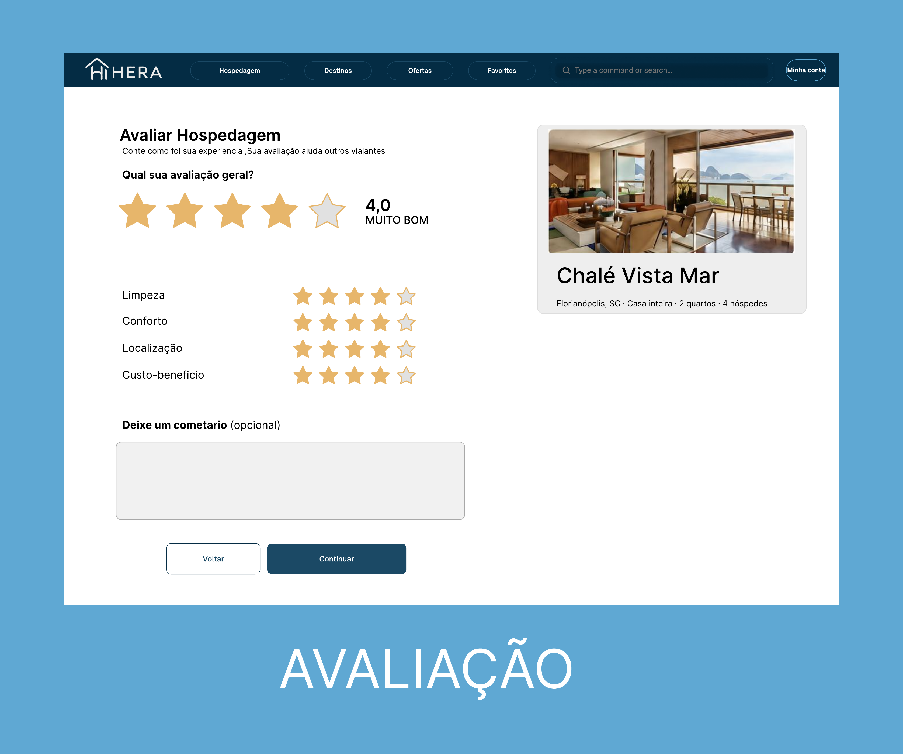

### Painel do proprietário

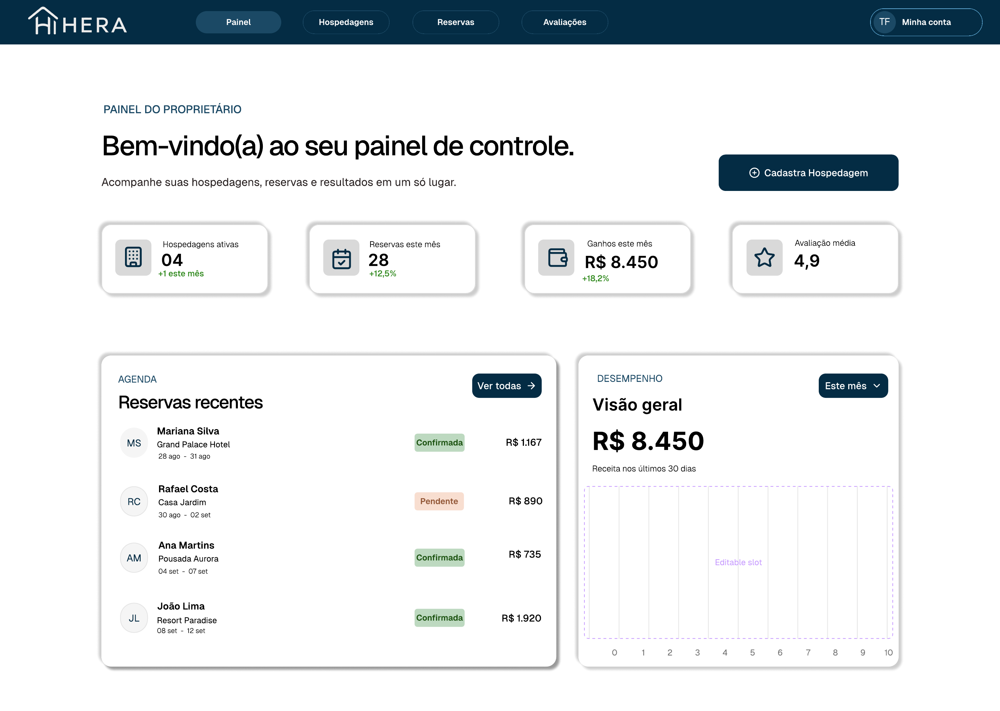

### Cadastrar hospedagem

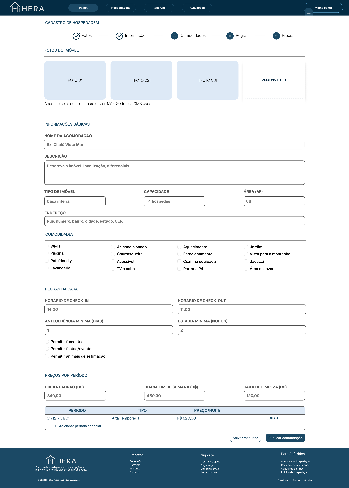

### Calendário e preços

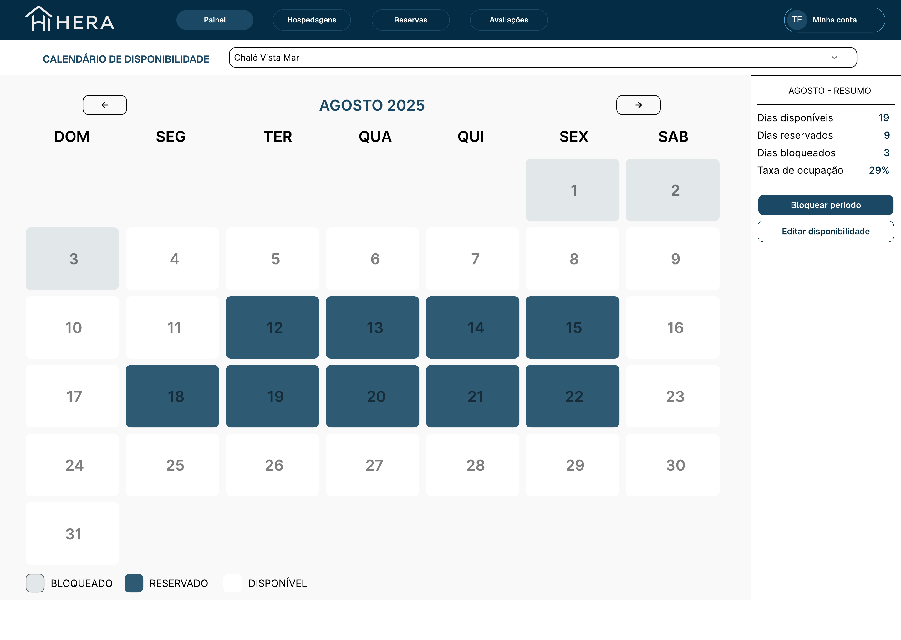

## Fluxo Completo Protótipo

[INSERIR IMAGENS DAS TELAS EM `img/`]


[ [INÍCIO](#projeto-de-software) ]

# Modelo Lógico do Banco de Dados

O banco de dados (MySQL) é composto por 20 tabelas, organizadas em quatro grupos:

* **Usuários:** `usuarios`, `cliente`, `proprietario`, `recuperacao_senha`, `preferencia` e `cliente_preferencia`.
* **Endereço:** `endereco`, `endereco_cep` e `endereco_cidade`.
* **Acomodações:** `cadastro_hospedagem`, `foto_hospedagem`, `comodidades`, `hospedagem_comodidades` e `preco_periodo`.
* **Reservas:** `reserva`, `cupom`, `pagamento`, `reserva_pagamento`, `avaliacao_hospedagem` e `avaliacao_cliente`.

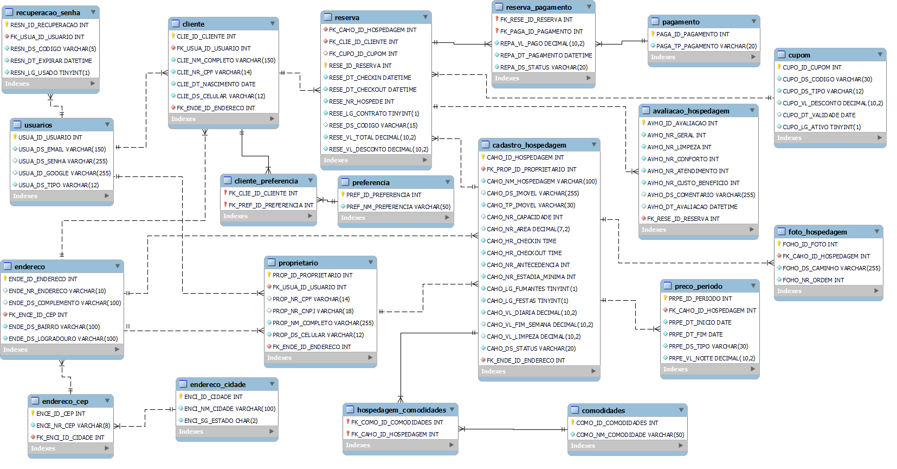

Script de criação do banco: [GESTAO_HOSPEDAGEM.sql](arquivos/GESTAO_HOSPEDAGEM.sql)

Dicionário de dados completo (tipo, nulo, padrão e chaves de cada campo): [dicionario_de_dados.md](banco_de_dados/dicionario_de_dados.md)

A tabela `RESERVA` tem o campo `RESE_DS_STATUS` (situação da reserva), com valor padrão `'PENDENTE'` e valores restritos a `PENDENTE`, `CONFIRMADA`, `CANCELADA` e `CONCLUIDA` ([issue #73](https://gitlab.fslab.dev/fabrica-de-software-i-2026/projeto5/-/issues/73)).

Modelo editável: [arquivos/](arquivos/)

## Dicionário de Dados

### USUARIOS

Contas de acesso à plataforma. Cada usuário pode ter um perfil de cliente e/ou de proprietário.

| CAMPO | TIPO SQL | TIPO | OPÇÕES | DESCRIÇÃO |
|:---|:---|:---|:---|:---|
| `USUA_ID_USUARIO` | INT | PK | NOT NULL, AUTO_INCREMENT | Identificador do usuário |
| `USUA_DS_EMAIL` | VARCHAR(150) | UNIQUE | NOT NULL | E-mail de acesso do usuário |
| `USUA_DS_SENHA` | VARCHAR(255) | Simples | NULL | Senha criptografada (hash). Fica vazia quando o acesso é pela conta Google |
| `USUA_ID_GOOGLE` | VARCHAR(255) | UNIQUE | NULL | Identificador da conta Google vinculada |
| `USUA_DS_TIPO` | VARCHAR(12) | Simples | NOT NULL | Tipo de usuário (cliente ou proprietário) |

### RECUPERACAO_SENHA

Solicitações de recuperação de senha. Cada solicitação gera um código próprio, com prazo de validade e uso único.

| CAMPO | TIPO SQL | TIPO | OPÇÕES | DESCRIÇÃO |
|:---|:---|:---|:---|:---|
| `RESN_ID_RECUPERACAO` | INT | PK | NOT NULL, AUTO_INCREMENT | Identificador da solicitação de recuperação |
| `FK_USUA_ID_USUARIO` | INT | FK | NOT NULL | Usuário que solicitou a recuperação (USUARIOS) |
| `RESN_DS_CODIGO` | VARCHAR(5) | Simples | NOT NULL | Código de verificação enviado ao e-mail |
| `RESN_DT_EXPIRAR` | DATETIME | Simples | NOT NULL | Data e hora em que o código expira |
| `RESN_LG_USADO` | TINYINT(1) | Simples | NOT NULL, DEFAULT 0 | Indica se o código já foi usado (0 = não, 1 = sim) |

### CLIENTE

Dados pessoais do perfil de cliente (hóspede).

| CAMPO | TIPO SQL | TIPO | OPÇÕES | DESCRIÇÃO |
|:---|:---|:---|:---|:---|
| `CLIE_ID_CLIENTE` | INT | PK | NOT NULL, AUTO_INCREMENT | Identificador do cliente |
| `FK_USUA_ID_USUARIO` | INT | FK / UNIQUE | NOT NULL | Conta de usuário do cliente (USUARIOS). Um usuário tem no máximo um perfil de cliente |
| `CLIE_NM_COMPLETO` | VARCHAR(150) | Simples | NOT NULL | Nome completo do cliente |
| `CLIE_NR_CPF` | VARCHAR(14) | UNIQUE | NOT NULL | CPF do cliente |
| `CLIE_DT_NASCIMENTO` | DATE | Simples | NOT NULL | Data de nascimento do cliente |
| `CLIE_DS_CELULAR` | VARCHAR(12) | Simples | NOT NULL | Número de celular do cliente |
| `FK_ENDE_ID_ENDERECO` | INT | FK | NOT NULL | Endereço do cliente (ENDERECO) |

### PROPRIETARIO

Dados do perfil de proprietário, pessoa física (CPF) ou jurídica (CNPJ).

| CAMPO | TIPO SQL | TIPO | OPÇÕES | DESCRIÇÃO |
|:---|:---|:---|:---|:---|
| `PROP_ID_PROPRIETARIO` | INT | PK | NOT NULL, AUTO_INCREMENT | Identificador do proprietário |
| `FK_USUA_ID_USUARIO` | INT | FK / UNIQUE | NOT NULL | Conta de usuário do proprietário (USUARIOS). Um usuário tem no máximo um perfil de proprietário |
| `PROP_NR_CPF` | VARCHAR(14) | UNIQUE | NULL | CPF do proprietário pessoa física. Deve ser informado o CPF ou o CNPJ |
| `PROP_NR_CNPJ` | VARCHAR(18) | UNIQUE | NULL | CNPJ do proprietário pessoa jurídica. Deve ser informado o CPF ou o CNPJ |
| `PROP_NM_COMPLETO` | VARCHAR(255) | Simples | NOT NULL | Nome completo ou razão social do proprietário |
| `PROP_DS_CELULAR` | VARCHAR(12) | Simples | NOT NULL | Número de celular do proprietário |
| `FK_ENDE_ID_ENDERECO` | INT | FK | NOT NULL | Endereço do proprietário (ENDERECO) |

### PREFERENCIA

Lista de preferências de hospedagem que o cliente pode escolher (ex.: praia, pet friendly).

| CAMPO | TIPO SQL | TIPO | OPÇÕES | DESCRIÇÃO |
|:---|:---|:---|:---|:---|
| `PREF_ID_PREFERENCIA` | INT | PK | NOT NULL, AUTO_INCREMENT | Identificador da preferência |
| `PREF_NM_PREFERENCIA` | VARCHAR(50) | Simples | NOT NULL | Nome da preferência |

### CLIENTE_PREFERENCIA

Associação entre clientes e preferências (relacionamento N:N).

| CAMPO | TIPO SQL | TIPO | OPÇÕES | DESCRIÇÃO |
|:---|:---|:---|:---|:---|
| `FK_CLIE_ID_CLIENTE` | INT | PK / FK | NOT NULL | Cliente (CLIENTE) |
| `FK_PREF_ID_PREFERENCIA` | INT | PK / FK | NOT NULL | Preferência escolhida pelo cliente (PREFERENCIA) |

### ENDERECO_CIDADE

Cidades e seus estados.

| CAMPO | TIPO SQL | TIPO | OPÇÕES | DESCRIÇÃO |
|:---|:---|:---|:---|:---|
| `ENCI_ID_CIDADE` | INT | PK | NOT NULL, AUTO_INCREMENT | Identificador da cidade |
| `ENCI_NM_CIDADE` | VARCHAR(100) | Simples | NOT NULL | Nome da cidade |
| `ENCI_SG_ESTADO` | CHAR(2) | Simples | NOT NULL | Sigla do estado (UF) |

### ENDERECO_CEP

CEPs cadastrados. Cada CEP pertence a uma única cidade.

| CAMPO | TIPO SQL | TIPO | OPÇÕES | DESCRIÇÃO |
|:---|:---|:---|:---|:---|
| `ENCE_ID_CEP` | INT | PK | NOT NULL, AUTO_INCREMENT | Identificador do CEP |
| `ENCE_NR_CEP` | VARCHAR(8) | UNIQUE | NOT NULL | Número do CEP, somente dígitos |
| `FK_ENCI_ID_CIDADE` | INT | FK | NOT NULL | Cidade do CEP (ENDERECO_CIDADE) |

### ENDERECO

Endereços de clientes, proprietários e hospedagens.

| CAMPO | TIPO SQL | TIPO | OPÇÕES | DESCRIÇÃO |
|:---|:---|:---|:---|:---|
| `ENDE_ID_ENDERECO` | INT | PK | NOT NULL, AUTO_INCREMENT | Identificador do endereço |
| `ENDE_NR_ENDERECO` | VARCHAR(10) | Simples | NULL | Número do imóvel (pode ser vazio, ex.: "s/n") |
| `ENDE_DS_COMPLEMENTO` | VARCHAR(100) | Simples | NULL | Complemento do endereço (apartamento, bloco etc.) |
| `FK_ENCE_ID_CEP` | INT | FK | NOT NULL | CEP do endereço (ENDERECO_CEP) |
| `ENDE_DS_BAIRRO` | VARCHAR(100) | Simples | NOT NULL | Bairro |
| `ENDE_DS_LOGRADOURO` | VARCHAR(100) | Simples | NOT NULL | Logradouro (rua, avenida etc.) |

### CADASTRO_HOSPEDAGEM

Hospedagens cadastradas pelos proprietários. Toda hospedagem começa como rascunho até ser publicada.

| CAMPO | TIPO SQL | TIPO | OPÇÕES | DESCRIÇÃO |
|:---|:---|:---|:---|:---|
| `CAHO_ID_HOSPEDAGEM` | INT | PK | NOT NULL, AUTO_INCREMENT | Identificador da hospedagem |
| `FK_PROP_ID_PROPRIETARIO` | INT | FK | NOT NULL | Proprietário da hospedagem (PROPRIETARIO) |
| `CAHO_NM_HOSPEDAGEM` | VARCHAR(100) | Simples | NOT NULL | Nome da hospedagem exibido no anúncio |
| `CAHO_DS_IMOVEL` | VARCHAR(255) | Simples | NULL | Descrição do imóvel |
| `CAHO_TP_IMOVEL` | VARCHAR(30) | Simples | NOT NULL | Tipo de imóvel (casa, apartamento, chalé, pousada etc.) |
| `CAHO_NR_CAPACIDADE` | INT | Simples | NULL | Número máximo de hóspedes |
| `CAHO_NR_AREA` | DECIMAL(7,2) | Simples | NULL | Área do imóvel, em m² |
| `CAHO_HR_CHECKIN` | TIME | Simples | NOT NULL | Horário de check-in |
| `CAHO_HR_CHECKOUT` | TIME | Simples | NOT NULL | Horário de check-out |
| `CAHO_NR_ANTECEDENCIA` | INT | Simples | NOT NULL | Antecedência mínima para reservar, em dias |
| `CAHO_NR_ESTADIA_MINIMA` | INT | Simples | NOT NULL | Número mínimo de noites por reserva |
| `CAHO_LG_FUMANTES` | TINYINT(1) | Simples | NOT NULL, DEFAULT 0 | Indica se é permitido fumar (0 = não, 1 = sim) |
| `CAHO_LG_FESTAS` | TINYINT(1) | Simples | NOT NULL, DEFAULT 0 | Indica se são permitidas festas (0 = não, 1 = sim) |
| `CAHO_VL_DIARIA` | DECIMAL(10,2) | Simples | NOT NULL | Valor padrão da diária |
| `CAHO_VL_FIM_SEMANA` | DECIMAL(10,2) | Simples | NULL | Valor da diária nos fins de semana |
| `CAHO_VL_LIMPEZA` | DECIMAL(10,2) | Simples | NULL, DEFAULT 0.00 | Taxa de limpeza cobrada por reserva |
| `CAHO_DS_STATUS` | VARCHAR(20) | Simples | NOT NULL, DEFAULT 'RASCUNHO' | Situação da hospedagem (RASCUNHO ou PUBLICADA) |
| `FK_ENDE_ID_ENDERECO` | INT | FK / UNIQUE | NOT NULL | Endereço da hospedagem (ENDERECO). Cada endereço pertence a uma única hospedagem |

### FOTO_HOSPEDAGEM

Fotos das hospedagens, exibidas em ordem definida pelo proprietário.

| CAMPO | TIPO SQL | TIPO | OPÇÕES | DESCRIÇÃO |
|:---|:---|:---|:---|:---|
| `FOHO_ID_FOTO` | INT | PK | NOT NULL, AUTO_INCREMENT | Identificador da foto |
| `FK_CAHO_ID_HOSPEDAGEM` | INT | FK | NOT NULL | Hospedagem da foto (CADASTRO_HOSPEDAGEM) |
| `FOHO_DS_CAMINHO` | VARCHAR(255) | Simples | NOT NULL | Caminho ou URL do arquivo da foto |
| `FOHO_NR_ORDEM` | INT | Simples | NOT NULL | Posição da foto na galeria |

### COMODIDADES

Lista de comodidades que uma hospedagem pode oferecer (ex.: Wi-Fi, piscina).

| CAMPO | TIPO SQL | TIPO | OPÇÕES | DESCRIÇÃO |
|:---|:---|:---|:---|:---|
| `COMO_ID_COMODIDADES` | INT | PK | NOT NULL, AUTO_INCREMENT | Identificador da comodidade |
| `COMO_NM_COMODIDADE` | VARCHAR(50) | UNIQUE | NOT NULL | Nome da comodidade |

### HOSPEDAGEM_COMODIDADES

Associação entre hospedagens e comodidades (relacionamento N:N).

| CAMPO | TIPO SQL | TIPO | OPÇÕES | DESCRIÇÃO |
|:---|:---|:---|:---|:---|
| `FK_COMO_ID_COMODIDADES` | INT | PK / FK | NOT NULL | Comodidade oferecida (COMODIDADES) |
| `FK_CAHO_ID_HOSPEDAGEM` | INT | PK / FK | NOT NULL | Hospedagem que oferece a comodidade (CADASTRO_HOSPEDAGEM) |

### PRECO_PERIODO

Preços por noite diferenciados por período (ex.: alta temporada, feriados).

| CAMPO | TIPO SQL | TIPO | OPÇÕES | DESCRIÇÃO |
|:---|:---|:---|:---|:---|
| `PRPE_ID_PERIODO` | INT | PK | NOT NULL, AUTO_INCREMENT | Identificador do período |
| `FK_CAHO_ID_HOSPEDAGEM` | INT | FK | NOT NULL | Hospedagem a que o preço se aplica (CADASTRO_HOSPEDAGEM) |
| `PRPE_DT_INICIO` | DATE | Simples | NOT NULL | Data de início do período |
| `PRPE_DT_FIM` | DATE | Simples | NOT NULL | Data de fim do período |
| `PRPE_DS_TIPO` | VARCHAR(30) | Simples | NOT NULL | Tipo do período (ex.: alta temporada, feriado) |
| `PRPE_VL_NOITE` | DECIMAL(10,2) | Simples | NOT NULL | Valor da noite no período |

### CUPOM

Cupons de desconto que podem ser aplicados nas reservas.

| CAMPO | TIPO SQL | TIPO | OPÇÕES | DESCRIÇÃO |
|:---|:---|:---|:---|:---|
| `CUPO_ID_CUPOM` | INT | PK | NOT NULL, AUTO_INCREMENT | Identificador do cupom |
| `CUPO_DS_CODIGO` | VARCHAR(30) | UNIQUE | NOT NULL | Código que o cliente digita para usar o cupom |
| `CUPO_DS_TIPO` | VARCHAR(12) | Simples | NOT NULL | Tipo de desconto (percentual ou valor fixo) |
| `CUPO_VL_DESCONTO` | DECIMAL(10,2) | Simples | NOT NULL | Valor do desconto (percentual ou em reais, conforme o tipo) |
| `CUPO_DT_VALIDADE` | DATE | Simples | NULL | Data de validade do cupom. Vazio = sem prazo |
| `CUPO_LG_ATIVO` | TINYINT(1) | Simples | NOT NULL, DEFAULT 1 | Indica se o cupom está ativo (0 = não, 1 = sim) |

### RESERVA

Reservas feitas pelos clientes nas hospedagens.

| CAMPO | TIPO SQL | TIPO | OPÇÕES | DESCRIÇÃO |
|:---|:---|:---|:---|:---|
| `FK_CAHO_ID_HOSPEDAGEM` | INT | FK | NOT NULL | Hospedagem reservada (CADASTRO_HOSPEDAGEM) |
| `FK_CLIE_ID_CLIENTE` | INT | FK | NOT NULL | Cliente que fez a reserva (CLIENTE) |
| `FK_CUPO_ID_CUPOM` | INT | FK | NULL | Cupom aplicado na reserva (CUPOM). Vazio quando não há cupom |
| `RESE_ID_RESERVA` | INT | PK | NOT NULL, AUTO_INCREMENT | Identificador da reserva |
| `RESE_DT_CHECKIN` | DATETIME | Simples | NOT NULL | Data e hora de entrada |
| `RESE_DT_CHECKOUT` | DATETIME | Simples | NOT NULL | Data e hora de saída |
| `RESE_NR_HOSPEDE` | INT | Simples | NOT NULL | Número de hóspedes |
| `RESE_LG_CONTRATO` | TINYINT(1) | Simples | NOT NULL, DEFAULT 0 | Indica se o cliente aceitou o contrato (0 = não, 1 = sim) |
| `RESE_DS_CODIGO` | VARCHAR(15) | UNIQUE | NULL | Código da reserva exibido ao cliente (ex.: #HERA-02541) |
| `RESE_VL_TOTAL` | DECIMAL(10,2) | Simples | NOT NULL | Valor total da reserva |
| `RESE_VL_DESCONTO` | DECIMAL(10,2) | Simples | NOT NULL, DEFAULT 0.00 | Valor do desconto aplicado |
| `RESE_DS_STATUS` | VARCHAR(20) | Simples | NOT NULL, DEFAULT 'PENDENTE', CHECK | Situação da reserva: PENDENTE (solicitada, aguardando pagamento), CONFIRMADA (pagamento registrado), CANCELADA (cancelada antes do check-in) ou CONCLUIDA (estadia encerrada). Ver o [dicionário de dados](banco_de_dados/dicionario_de_dados.md#situação-da-reserva-rese_ds_status) |

### PAGAMENTO

Formas de pagamento aceitas (ex.: Pix, cartão de crédito).

| CAMPO | TIPO SQL | TIPO | OPÇÕES | DESCRIÇÃO |
|:---|:---|:---|:---|:---|
| `PAGA_ID_PAGAMENTO` | INT | PK | NOT NULL, AUTO_INCREMENT | Identificador da forma de pagamento |
| `PAGA_TP_PAGAMENTO` | VARCHAR(20) | Simples | NOT NULL | Nome da forma de pagamento |

### RESERVA_PAGAMENTO

Pagamentos de cada reserva. Uma reserva pode ser paga com várias formas combinadas.

| CAMPO | TIPO SQL | TIPO | OPÇÕES | DESCRIÇÃO |
|:---|:---|:---|:---|:---|
| `FK_RESE_ID_RESERVA` | INT | PK / FK | NOT NULL | Reserva paga (RESERVA) |
| `FK_PAGA_ID_PAGAMENTO` | INT | PK / FK | NOT NULL | Forma de pagamento usada (PAGAMENTO) |
| `REPA_VL_PAGO` | DECIMAL(10,2) | Simples | NOT NULL | Valor pago nessa forma de pagamento |
| `REPA_DT_PAGAMENTO` | DATETIME | Simples | NOT NULL | Data e hora do pagamento |
| `REPA_DS_STATUS` | VARCHAR(20) | Simples | NOT NULL | Situação do pagamento (ex.: pendente, aprovado, recusado) |

### AVALIACAO_HOSPEDAGEM

Avaliação da hospedagem feita pelo cliente. Cada reserva recebe no máximo uma avaliação.

| CAMPO | TIPO SQL | TIPO | OPÇÕES | DESCRIÇÃO |
|:---|:---|:---|:---|:---|
| `AVHO_ID_AVALIACAO` | INT | PK | NOT NULL, AUTO_INCREMENT | Identificador da avaliação |
| `AVHO_NR_GERAL` | INT | Simples | NOT NULL | Nota geral (1 a 5) |
| `AVHO_NR_LIMPEZA` | INT | Simples | NOT NULL | Nota de limpeza (1 a 5) |
| `AVHO_NR_CONFORTO` | INT | Simples | NOT NULL | Nota de conforto (1 a 5) |
| `AVHO_NR_ATENDIMENTO` | INT | Simples | NOT NULL | Nota de atendimento (1 a 5) |
| `AVHO_NR_CUSTO_BENEFICIO` | INT | Simples | NOT NULL | Nota de custo-benefício (1 a 5) |
| `AVHO_DS_COMENTARIO` | VARCHAR(255) | Simples | NULL | Comentário opcional do cliente |
| `AVHO_DT_AVALIACAO` | DATETIME | Simples | NULL, DEFAULT CURRENT_TIMESTAMP | Data e hora da avaliação |
| `FK_RESE_ID_RESERVA` | INT | FK / UNIQUE | NOT NULL | Reserva avaliada (RESERVA) |

### AVALIACAO_CLIENTE

Avaliação do cliente feita pelo proprietário. Cada reserva recebe no máximo uma avaliação.

| CAMPO | TIPO SQL | TIPO | OPÇÕES | DESCRIÇÃO |
|:---|:---|:---|:---|:---|
| `AVCL_ID_AVALIACAO` | INT | PK | NOT NULL, AUTO_INCREMENT | Identificador da avaliação |
| `AVCL_NR_GERAL` | INT | Simples | NOT NULL | Nota geral do cliente (1 a 5) |
| `AVCL_NR_COMUNICACAO` | INT | Simples | NOT NULL | Nota de comunicação (1 a 5) |
| `AVCL_NR_PONTUALIDADE` | INT | Simples | NOT NULL | Nota de pontualidade no check-in e no check-out (1 a 5) |
| `AVCL_NR_RESPEITO_REGRA` | INT | Simples | NOT NULL | Nota de respeito às regras da hospedagem (1 a 5) |
| `AVCL_NR_CUIDADO_IMOVEL` | INT | Simples | NOT NULL | Nota de cuidado com o imóvel (1 a 5) |
| `AVCL_DS_COMENTARIO` | VARCHAR(255) | Simples | NULL | Comentário opcional do proprietário |
| `AVCL_DT_AVALIACAO` | DATETIME | Simples | NULL, DEFAULT CURRENT_TIMESTAMP | Data e hora da avaliação |
| `FK_RESE_ID_RESERVA` | INT | FK / UNIQUE | NOT NULL | Reserva avaliada (RESERVA) |


[ [INÍCIO](#projeto-de-software) ]

# Diagrama de Atividades

[INSERIR DIAGRAMA DE ATIVIDADES EM `img/`]


# Diagrama de Sequência

### Solicitar Reserva

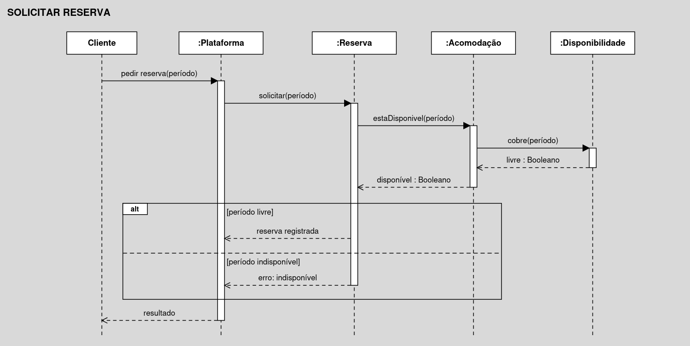

### Cadastrar Acomodação

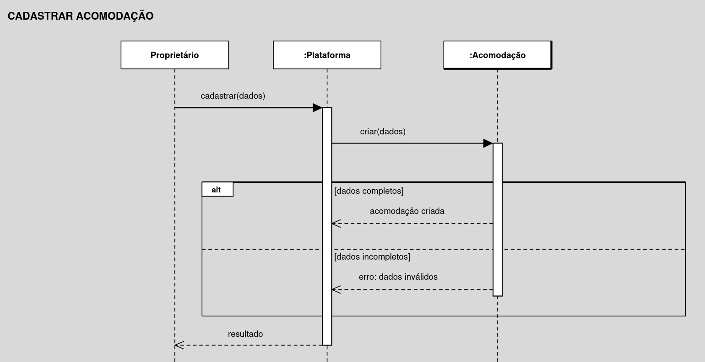


# Diagrama de Classes

### Usuários

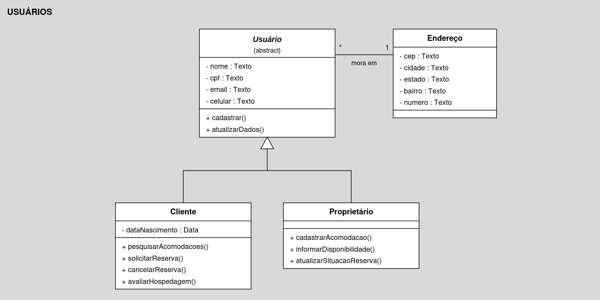

### Acomodações

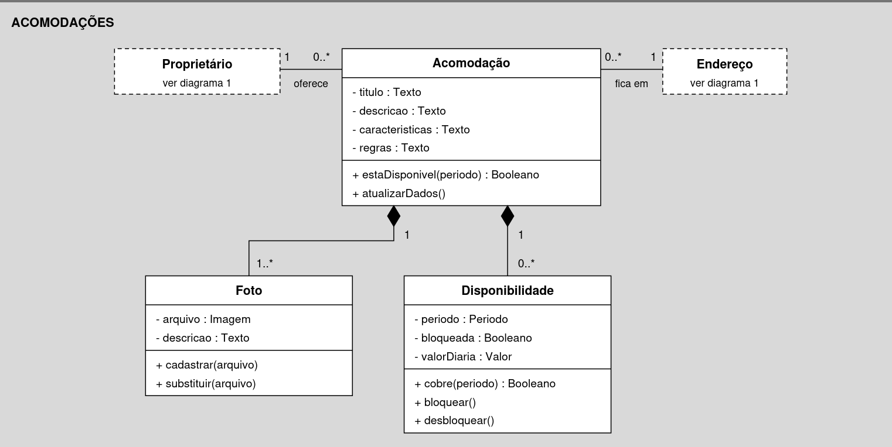

### Reservas e Avaliação

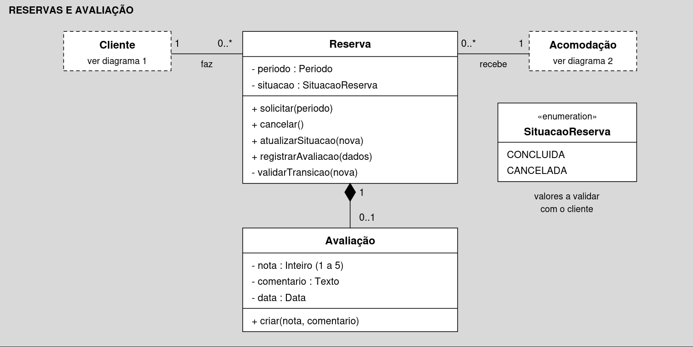

> Valores do enum `SituacaoReserva`: Pendente, Confirmada, Concluída e Cancelada (RF-006).


# Diagrama de Casos de Uso

### Diagrama geral (versão final)

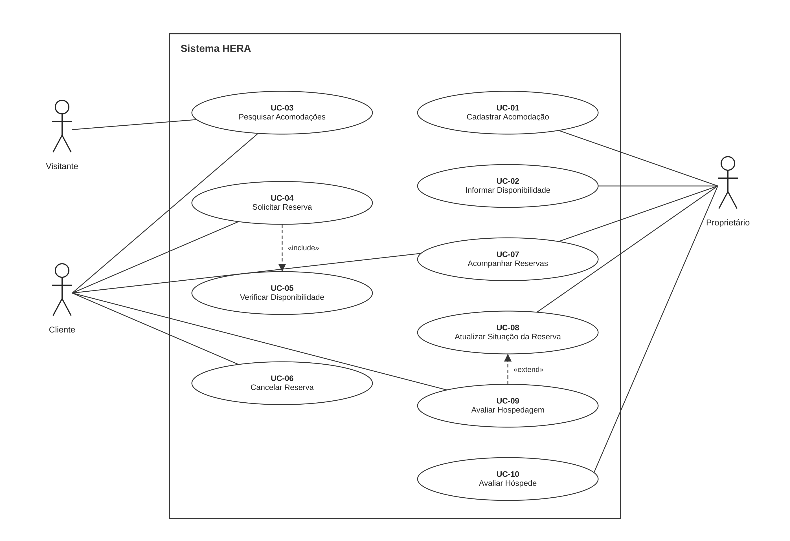

Arquivo editável: [img/diagrama_casos_de_uso.svg](img/diagrama_casos_de_uso.svg).

Decisões do grupo no Milestone 3: o perfil Administrador (RF-013 e RF-014, requisitos condicionais) ficou fora do escopo desta versão; foi incluído o UC-10 – Avaliar Hóspede; o bloqueio manual de datas não será implementado.

### Gestão de Acomodações

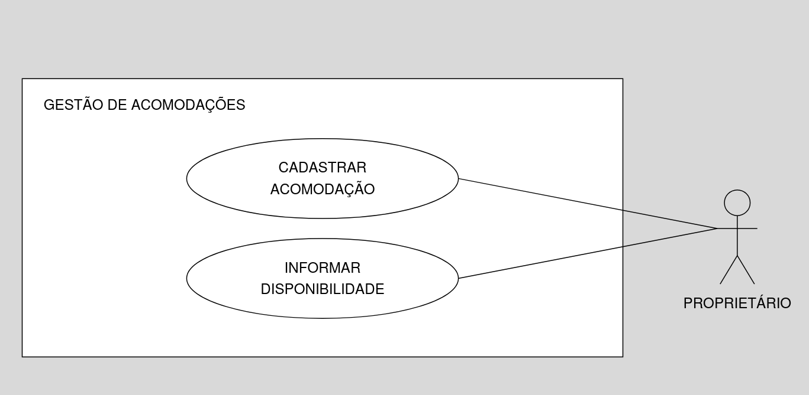

### Reserva de Hospedagem

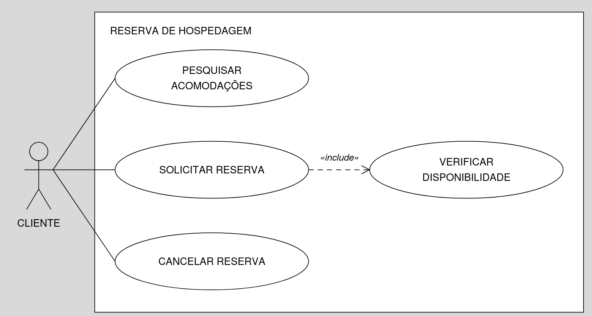

### Acompanhamento e Avaliação

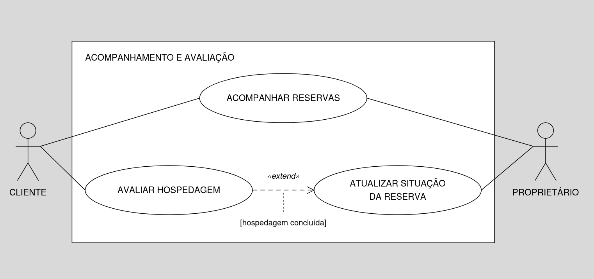


## Especificação dos Casos de Uso

### UC-01 - Cadastrar Acomodação

|UC-01 - Cadastrar Acomodação|
|:---|
|*Descrição/Objetivo:* Permite que o proprietário cadastre uma nova acomodação na plataforma.|
|*Atores:* Proprietário|
|*Pré-condições:* Proprietário autenticado no sistema.|
|*Pós-condições:* Acomodação cadastrada como rascunho. Ela só aparece nas pesquisas depois de publicada pelo proprietário (RN-010).|
|*FLUXO PRINCIPAL / BÁSICO:*|
|1. Proprietário acessa a opção "Cadastrar acomodação".|
|2. O sistema exibe o formulário com dados do imóvel, endereço, regras, preços e fotos.|
|3. Proprietário preenche os dados e adiciona as fotos (no mínimo 1 foto).|
|4. Proprietário confirma o cadastro.|
|5. O sistema valida se os dados obrigatórios estão completos.|
|6. O sistema cria a acomodação e exibe mensagem de sucesso.|
|7. Proprietário publica a acomodação, que passa a aparecer nas pesquisas.|
|*FLUXOS ALTERNATIVOS / EXCEÇÕES:*|
|*A1: Dados incompletos ou inválidos:*|
|1. No passo 5, o sistema identifica campos obrigatórios ausentes ou inválidos, ou nenhuma foto.|
|2. O sistema exibe a mensagem "dados inválidos", indicando os campos.|
|3. Proprietário corrige os dados e o fluxo retorna ao passo 4.|

### UC-02 - Informar Disponibilidade

|UC-02 - Informar Disponibilidade|
|:---|
|*Descrição/Objetivo:* Permite que o proprietário defina os preços por período de uma acomodação.|
|*Atores:* Proprietário|
|*Pré-condições:* Proprietário autenticado e com ao menos uma acomodação cadastrada.|
|*Pós-condições:* Preços por período da acomodação atualizados.|
|*FLUXO PRINCIPAL / BÁSICO:*|
|1. Proprietário seleciona uma de suas acomodações.|
|2. O sistema exibe os períodos com preço definido e os períodos reservados.|
|3. Proprietário seleciona um período e define o preço por noite.|
|4. O sistema valida o período e salva a alteração.|
|*FLUXOS ALTERNATIVOS / EXCEÇÕES:*|
|*A1: Data final anterior à inicial:*|
|1. No passo 4, o sistema exibe alerta e solicita a correção do período.|

### UC-03 - Pesquisar Acomodações

|UC-03 - Pesquisar Acomodações|
|:---|
|*Descrição/Objetivo:* Permite que o cliente encontre acomodações de acordo com seus critérios.|
|*Atores:* Cliente, Visitante|
|*Pré-condições:* Nenhuma.|
|*Pós-condições:* Lista de acomodações compatíveis exibida.|
|*FLUXO PRINCIPAL / BÁSICO:*|
|1. Cliente informa cidade, datas de check-in e check-out e número de hóspedes e, se quiser, aplica filtros de preço, avaliação, tipo e comodidades.|
|2. O sistema busca as acomodações compatíveis e disponíveis no período.|
|3. O sistema exibe a lista com foto, nome, preço e nota média.|
|4. Cliente seleciona uma acomodação e o sistema exibe seus detalhes.|
|*FLUXOS ALTERNATIVOS / EXCEÇÕES:*|
|*A1: Nenhum resultado:*|
|1. No passo 2, o sistema informa que não há acomodações para os critérios e sugere alterar a busca.|

### UC-04 - Solicitar Reserva

|UC-04 - Solicitar Reserva|
|:---|
|*Descrição/Objetivo:* Permite que o cliente reserve uma acomodação para um período.|
|*Atores:* Cliente|
|*Pré-condições:* Cliente autenticado e acomodação selecionada.|
|*Pós-condições:* Reserva registrada com situação "Pendente" e o período ocupado na acomodação.|
|*FLUXO PRINCIPAL / BÁSICO:*|
|1. Cliente informa o período e o número de hóspedes e solicita a reserva.|
|2. O sistema verifica a disponibilidade do período (inclui UC-05).|
|3. O sistema calcula e exibe o valor total (diárias, taxa de limpeza e descontos).|
|4. Cliente confirma a reserva e aceita o contrato da hospedagem.|
|5. O sistema registra a reserva e exibe o código da reserva.|
|6. Cliente realiza o pagamento, podendo combinar mais de uma forma de pagamento (RF-011).|
|*FLUXOS ALTERNATIVOS / EXCEÇÕES:*|
|*A1: Período indisponível:*|
|1. No passo 2, o sistema retorna "indisponível" e solicita outro período.|
|*A2: Hóspedes acima da capacidade:*|
|1. No passo 1, o sistema informa a capacidade máxima e solicita a correção.|
|*A3: Cupom de desconto:*|
|1. No passo 3, cliente informa um cupom.|
|2. Se o cupom estiver ativo e válido, o sistema aplica o desconto; caso contrário, informa que o cupom é inválido.|
|*A4: Pagamento recusado:*|
|1. No passo 6, o sistema informa a recusa e permite tentar outra forma de pagamento.|

### UC-05 - Verificar Disponibilidade

|UC-05 - Verificar Disponibilidade|
|:---|
|*Descrição/Objetivo:* Verifica se a acomodação está livre no período solicitado. É incluído pelo UC-04.|
|*Atores:* Nenhum ator direto (incluído pelo UC-04)|
|*Pré-condições:* Período e acomodação informados.|
|*Pós-condições:* Resultado "disponível" ou "indisponível" retornado.|
|*FLUXO PRINCIPAL / BÁSICO:*|
|1. O sistema consulta as reservas ativas da acomodação.|
|2. Se não houver sobreposição, retorna "disponível"; caso contrário, "indisponível".|
|*FLUXOS ALTERNATIVOS / EXCEÇÕES:*|
|Não há fluxos alternativos. O resultado "indisponível" é tratado no passo 2 do fluxo principal e devolvido ao UC-04 (fluxo A1).|

### UC-06 - Cancelar Reserva

|UC-06 - Cancelar Reserva|
|:---|
|*Descrição/Objetivo:* Permite que o cliente cancele uma reserva.|
|*Atores:* Cliente|
|*Pré-condições:* Cliente autenticado com reserva ainda não concluída.|
|*Pós-condições:* Reserva com situação "Cancelada" e período liberado na acomodação.|
|*FLUXO PRINCIPAL / BÁSICO:*|
|1. Cliente acessa "Minhas reservas" e seleciona a reserva.|
|2. Cliente escolhe "Cancelar reserva".|
|3. O sistema pede confirmação.|
|4. Cliente confirma.|
|5. O sistema altera a situação para "Cancelada" e libera o período.|
|*FLUXOS ALTERNATIVOS / EXCEÇÕES:*|
|*A1: Reserva já concluída ou cancelada:*|
|1. No passo 2, o sistema não exibe a opção de cancelamento.|

### UC-07 - Acompanhar Reservas

|UC-07 - Acompanhar Reservas|
|:---|
|*Descrição/Objetivo:* Permite que cliente e proprietário consultem suas reservas.|
|*Atores:* Cliente, Proprietário|
|*Pré-condições:* Usuário autenticado.|
|*Pós-condições:* Lista de reservas exibida.|
|*FLUXO PRINCIPAL / BÁSICO:*|
|1. Usuário acessa "Minhas reservas" (cliente) ou "Reservas recebidas" (proprietário).|
|2. O sistema exibe as reservas com acomodação, período, valor e situação.|
|3. Usuário seleciona uma reserva para ver os detalhes.|
|*FLUXOS ALTERNATIVOS / EXCEÇÕES:*|
|*A1: Nenhuma reserva:*|
|1. No passo 2, o sistema informa que não há reservas.|

### UC-08 - Atualizar Situação da Reserva

|UC-08 - Atualizar Situação da Reserva|
|:---|
|*Descrição/Objetivo:* Permite que o proprietário atualize a situação de uma reserva da sua acomodação.|
|*Atores:* Proprietário|
|*Pré-condições:* Proprietário autenticado com reserva recebida.|
|*Pós-condições:* Situação da reserva atualizada. Se "Concluída", o cliente passa a poder avaliar (UC-09).|
|*FLUXO PRINCIPAL / BÁSICO:*|
|1. Proprietário seleciona uma reserva recebida.|
|2. Proprietário escolhe a nova situação.|
|3. O sistema valida se a transição é permitida.|
|4. O sistema salva a nova situação.|
|*FLUXOS ALTERNATIVOS / EXCEÇÕES:*|
|*A1: Transição inválida:*|
|1. No passo 3, se a transição não for permitida, o sistema informa e mantém a situação atual. (transições válidas: Pendente → Confirmada, Confirmada → Concluída, Pendente ou Confirmada → Cancelada)|

### UC-09 - Avaliar Hospedagem

|UC-09 - Avaliar Hospedagem|
|:---|
|*Descrição/Objetivo:* Permite que o cliente avalie a hospedagem. Estende o UC-08 quando a hospedagem é concluída.|
|*Atores:* Cliente|
|*Pré-condições:* Reserva com situação "Concluída" e ainda sem avaliação.|
|*Pós-condições:* Avaliação registrada e exibida na página da acomodação.|
|*FLUXO PRINCIPAL / BÁSICO:*|
|1. Cliente acessa a reserva concluída e escolhe "Avaliar".|
|2. O sistema exibe o formulário de avaliação.|
|3. Cliente informa notas de 1 a 5 (geral, limpeza, conforto, atendimento e custo-benefício) e, opcionalmente, um comentário.|
|4. O sistema registra a avaliação.|
|*FLUXOS ALTERNATIVOS / EXCEÇÕES:*|
|*A1: Reserva já avaliada:*|
|1. No passo 1, o sistema informa que a reserva já foi avaliada.|
|*A2: Nota fora do intervalo:*|
|1. No passo 3, o sistema solicita notas entre 1 e 5.|

### UC-10 - Avaliar Hóspede

|UC-10 - Avaliar Hóspede|
|:---|
|*Descrição/Objetivo:* Permite que o proprietário avalie o cliente após a hospedagem concluída.|
|*Atores:* Proprietário|
|*Pré-condições:* Reserva com situação "Concluída" e ainda sem avaliação do cliente.|
|*Pós-condições:* Avaliação do cliente registrada.|
|*FLUXO PRINCIPAL / BÁSICO:*|
|1. Proprietário acessa a reserva concluída e escolhe "Avaliar hóspede".|
|2. O sistema exibe o formulário.|
|3. Proprietário informa notas de 1 a 5 (geral, comunicação, pontualidade, respeito às regras e cuidado com o imóvel) e, opcionalmente, um comentário.|
|4. O sistema registra a avaliação.|
|*FLUXOS ALTERNATIVOS / EXCEÇÕES:*|
|*A1: Cliente já avaliado:*|
|1. No passo 1, o sistema informa que o cliente já foi avaliado nessa reserva.|
|*A2: Nota fora do intervalo:*|
|1. No passo 3, o sistema solicita notas entre 1 e 5.|


[ [INÍCIO](#projeto-de-software) ]

# REFERÊNCIAS

Esta subseção apresenta as referências aos documentos que utilizamos no auxílio à construção deste documento.
* [UML](https://www.omg.org/spec/UML/2.5/About-UML/)
* [Práticas para Especificação de Requisitos IEEE-830](https://ieeexplore.ieee.org/document/720574)
* [Lei Geral de Proteção de Dados (Lei nº 13.709/2018)](https://www.planalto.gov.br/ccivil_03/_ato2015-2018/2018/lei/l13709.htm)
